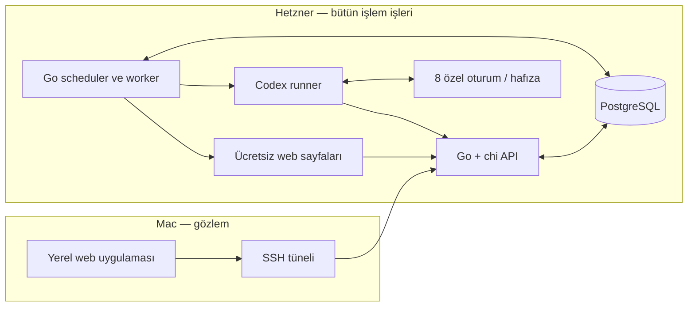

# Canlı Trading MVP — Uygulama ve Teknik Plan

Güncelleme: 8 Ekim 2026. Durum: son genel belge revizyonu tamamlandı; ürün kodu, kurulum, giriş ve sunucu bağlantısı henüz yapılmadı. Plan kararları tamamlanmıştır; gerçek abonelik erişimi ve üç güncel fiyat kaynağının Hetzner'de çalışması kurulum kabul koşuludur. Bu koşullar geçmeden çalışan trading pilotu ilan edilmez.

Bu belge güncel teknik uygulama sözleşmesidir. Ürün kararları ve kaynak kapsamı [deney-plani.md](research/deney-plani.md) içindedir. Önceki beş belgenin değiştirilmeden korunmuş kopyaları [arşivdedir](research/archive-2026-10-08/MVP-TEKNIK-PLAN.md). Arşivdeki sayısal ETF/Python/API pilotu güncel MVP'nin gereksinimi değildir.

## 1. Son kapsam kararları

| Konu | Kesin kapsam |
|---|---|
| Ana ürün | Canlı ileriye dönük, sekiz ayrı sanal cüzdanın işlem yaptığı pilot A |
| Kategoriler | ABD hisseleri, QQQ, TQQQ, EWC |
| Cüzdanlar | ABD'de 3, QQQ'da 2, TQQQ'da 2, EWC'de 1; her biri 100.000 USD |
| Yetki | Kendi nakdiyle sahip olduğu hisse/ETF'yi al-sat; borç, faiz, margin, short ve türev yok |
| Serbestlik | Stratejik pozisyon/kayıp limiti, zorunlu nakit oranı veya tutma süresi yok |
| Model | Önce ChatGPT aboneliğiyle resmi Codex CLI; ayrı oturum ve özel hafıza |
| Veriler | Ücretsiz açık web araması/sayfa okuması; piyasa verisi API anahtarı ve ek veri aboneliği yok |
| Backend | Kendi Go + chi v5 uygulamamız; PostgreSQL |
| Yerleşim | Backend, PostgreSQL, model runner, hafıza ve bütün jobs Hetzner'de |
| Kullanıcı ekranı | Yalnız Mac'te çalışan yerel web uygulaması; Hetzner backendini okur |
| Değerlendirme | Benchmark, başarı skoru, yıllık %10 testi, model sıralama ve araştırma raporları şimdi yok |
| Sonraki ürünler | Tarihsel B, Gemini, gerçek broker ve gerçek para daha sonraki ayrı kapsam |
| Deney süresi | Sabit bitiş tarihi yok; Mac'in açık olması backendin çalışmasına şart değil |

1–4 numaralı kalan kararların tümünü kullanıcı asistana bıraktı. Aşağıdaki varsayılanlar bu yetkiyle seçilmiştir; tekrar teknik değer onayı aranmaz. Hedef sunucu IP'si aşağıda kayıtlıdır; SSH kullanıcı, port ve anahtar uygunluğu kurulum sırasında doğrulanır.

## 2. Hetzner ve Mac yerleşimi

**Geliştirme ve çalışma ortamı: Hetzner, hedef IP: `167.235.158.118`.** Backend, model bağlantıları, veri toplama ve sunucu testleri bu uzaktaki ortamda geliştirilip çalıştırılır. Mac yalnız yerel web gözlem uygulaması, kaynak dosyalarının düzenlenmesi ve uzak ortama erişim için kullanılır.

**Bulunan hedef sunucu IP'si: 167.235.158.118.** 8 Ekim'de Mac'in ~/.ssh/known_hosts kayıtlarında ve anoons / 4-product-one-community projelerinin yerel deploy ayarlarında aynı IP bulundu; yerel Hetzner ayarı da bu adresi işaret ediyor. IP plana kaydedildi, sunucuya bağlantı kurulmadı. SSH kullanıcı/port/anahtar uygunluğu ve mevcut server servisleri uygulamanın ilk erişim incelemesinde doğrulanır; bu eski kayıt sunucunun bugün erişilebilir olduğunu kanıtlamaz.

Tek Hetzner sunucusunda Go HTTP servisi, worker/scheduler, PostgreSQL ve cüzdanlara özel Codex çalışma ortamları bulunur. Mevcut sunucu işletim sistemi ve kaynakları kurulumda okunur; sunucuyu sıfırlama veya yeni ücretli kaynak satın alma bu planın parçası değildir. Mevcut Linux dağıtımında container çalıştırma uygunsa Docker Compose ile dağıtım yapılır; sürümler kurulumda sabitlenir. [Docker Compose resmi belgesi](https://docs.docker.com/compose/). Yerel headless Chromium sadece kaynak sayfasının render gerektirdiği durumda çalışır. Ücretli veri servisi veya görünmeyen piyasa API'sine geçiş yapılmaz.

Mac tarafı sade HTML/CSS ve vanilla TypeScript web uygulamasıdır. Yerel frontend sunucusu yalnız 127.0.0.1'e bağlanır; /api isteklerini SSH tüneli üzerinden Hetzner'deki kendi Go API'mize proxy eder. Bu yerel servis statik dosya sunumu/proxy dışında cüzdan muhasebesi, model bağlantısı veya zamanlayıcı çalıştırmaz. [Vite](https://vite.dev/guide/) frontend geliştirmesinde kullanılır; üretim kullanımında aynı yerel dosya/proxy sözleşmesi korunur.

Backend HTTP portu ilk sürümde sunucu localhost'una bağlıdır; veritabanı internete açılmaz. Mac–Hetzner ulaşımı SSH tüneliyle sağlanır. Model/worker iç erişimi cüzdana bağlı yetkiyle yapılır; kullanıcı oturumu ayrı kimliktir. Mac kapanınca görüntüleme kesilir; server jobs çalışır. Model kimlik bilgileri Mac frontendine gönderilmez. Public domain, internetten açık dashboard ve TLS reverse proxy bu özel ilk kurulumun zorunluluğu değildir.

chi sadece HTTP yönlendirme ve middleware katmanıdır; hazır trading motoru değildir. Emir, gerçekleşme, muhasebe, oturum yürütme ve kendi API'miz Go ile yazılır. Kaynak: [chi resmi proje belgesi](https://github.com/go-chi/chi).

## 3. Veri hattı ve fiyat kaynakları

### 3.1. Edinim

Model canlı web aramasıyla belge/sayfayı bulur ve okunabilen olguları kaynaklarıyla çıkarır. Emir öncesi fiyat, Go worker'ın seçili açık ürün sayfalarını yeniden okumasıyla doğrulanır. Gerektiğinde sunucudaki headless tarayıcı görünen sayfayı render eder. Kaynak okuyucusu kaynağa özel alanları çıkartır; doğrulamayı Go yapar. Arama özeti, model hafızası, sayfanın HTTP Date başlığı veya sayfanın yeni açılmış olması fiyat olay zamanını ispatlamaz.

Bir veri API anahtarı kullanılmaz; halka açık sayfa okuma, kullanıcı seçtiği ücretsiz web yönteminin içindedir. Gizli quote API'lerini tersine çevirme, erişim engeli/CAPTCHA aşma veya yeni veri hesabı açma bu planın yöntemleri değildir. Kaynakta gerekli alan görünmüyorsa eksik kalır.

### 3.2. Seçilen kaynak havuzu

Sıra: **Stock Analysis → Yahoo Finance → Webull**. **Nasdaq** teknik erişimi/güncelliği geçerse yedektir. Nasdaq varsayılan zorunlu üçüncü kaynak olmaktan çıkarıldı; 8 Ekim kontrolde sayfa fiyat vermedi. Webull yeni ücretsiz erişim adayıdır. Bir sembolde önce metadata/zaman/erişim koşullarını geçen ilk üç site seçilir; fiyatları daha çok uyuşan üçlü sonradan aranmaz. Üçlüde fark koşulu geçmezse tamamı yeniden kontrol edilir; yalnız aykırı fiyat diye kaynak çıkarılmaz.

| Ürün | Stock Analysis | Yahoo | Webull |
|---|---|---|---|
| ABD hissesi | /stocks/{site-slug}/ | /quote/{alias}/ | /quote/{exchange-symbol-slug} |
| QQQ | https://stockanalysis.com/etf/qqq/ | https://finance.yahoo.com/quote/QQQ/ | https://www.webull.com/quote/nasdaq-qqq |
| TQQQ | https://stockanalysis.com/etf/tqqq/ | https://finance.yahoo.com/quote/TQQQ/ | https://www.webull.com/quote/nasdaq-tqqq |
| EWC | https://stockanalysis.com/etf/ewc/ | https://finance.yahoo.com/quote/EWC/ | https://www.webull.com/quote/nysearca-ewc |

Hisse site URL'leri sabit sembol dönüştürme varsayımıyla üretilmez; varlık–kaynak alias haritası gerçek ürün sayfasıyla kurulur. BRK.B gibi hisse sınıfları tek kalıcı asset ID altında korunur.

8 Ekim 2026, yaklaşık 03:06 UTC kontrolünde ABD normal seansı kapalıydı. Stock Analysis QQQ fiyat/seans zamanı gösterdi. Webull QQQ, TQQQ, EWC ve AAPL sayfaları okunabildi; düzenli fiyatın ayrı güncel zaman damgası sayfa metninde tam kanıtlanmadı. Yahoo QQQ isteği 429 verdi. Nasdaq QQQ fiyatı kullanılamıyordu. Bunlar Hetzner erişim veya canlı üçlü kabul testi değildir. Webull'un ücretsiz Nasdaq Basic paketi hesabındaki kullanıcı erişimine ilişkin belgesidir; public sayfanın login olmadan aynı alanları sunduğunu garanti etmez.

Kaynaklar: [Stock Analysis güncelleme bilgisi](https://stockanalysis.com/help/faq/stock-price-data/), [QQQ sayfası ve feed açıklaması](https://stockanalysis.com/etf/qqq/), [Webull market data belgesi](https://www.webull.com/help/faq/126-What-market-data-is-available-on-Webull), [Webull QQQ](https://www.webull.com/quote/nasdaq-qqq), [Nasdaq QQQ](https://www.nasdaq.com/market-activity/etf/qqq).

Investing.com fiyat kaynağına eklenmedi: ürün sayfası fiyatı indicative olarak niteliyor ve veri kullanım/saklama için açık izin koşulu koyuyor. CNBC bu okuma yolunda robots engeli verdi; Seeking Alpha sayfası uygun canlı fiyat alanını kanıtlamadı. Ücretsiz site etiketi otomatik kullanım hakkı veya fiyat güncelliği kanıtı değildir. Kaynak bazında kullanılabilir yöntem kurulumda kaydedilir; açık kısıtla uyuşmayan yol kullanılmaz. Investing/Trading Economics takvimleri yalnız kaynak keşfinde adaydır; backend değer saklama yolu otomatik onaylanmış değildir. Resmi olay takvimleri ve birincil sonuç belgeleri önceliklidir. [Investing.com ürün sayfası açıklaması](https://www.investing.com/etfs/powershares-qqqq).

### 3.3. Değişmeyen emir fiyatı koşulları

- Üç farklı sitede aynı asset ID/sınıf, USD, aynı normal seans ve son işlem fiyat türü.
- Her kayıt sonlu/pozitif; olay zamanı kontrol sonunda en fazla 60 saniye eski.
- En yeni/en eski olay zamanları en fazla 60 saniye ayrı; gelecek zaman kabul edilmez.
- 100 × (max − min) / median en fazla %1; tam %1 geçer.
- Üç site aynı feed kullanabilir; sitelerin uyumu üç bağımsız piyasa feed'i diye sunulmaz.
- 15 dakika gecikmiş fiyat, kapanış/NAV/after-hours fiyatı normal seans canlı fiyatı yerine geçmez.
- Koşullar geçmiyorsa price_unverified. Üçü ikiye indirme, eşiği büyütme veya geriye fill yazma yok.
- Emir kararı sonrası fiyat tekrar okunur. Doğrulanmış fiyat da gerçekleşebilir likiditeyi tek başına kanıtlamaz.

Piyasa kapalıyken aynı seansın resmi/kanıtlı kapanışları araştırma ve değerleme için kullanılabilir; o sırada işlem gerçekleşmez. Kaynak değişiklikleri sürümlenir.

### 3.4. Veri çekme aşamasında kaynak testi

Kullanıcının 8 Ekim yönlendirmesiyle bu kontrol **veri çekme prototipi geliştirilirken, bütün backend/emir/hafıza/ekran yapısının bitmesi beklenmeden** yapılır. Küçük kaynak okuyucuları Hetzner'de denenir; fiyatın güncelliği ve likidite alanları burada ölçülür. Eksik kaynağın okuyucusu veya kaynak seçimi bu aşamada güncellenip tekrar denenir. Genel yapının tamamlanmasından sonraya bırakılan ayrı bir kaynak sınavı değildir.

Hetzner'de normal seans içinde QQQ, TQQQ, EWC ve sabit listeden AAPL, JPM, XOM, BRK.B için ilk oturumdan ve kapanış öncesi oturumdan örnekler alınır. Seçilen üç site aynı döngüde kimlik, tür, kaynak olay zamanı ve fark koşullarını geçmelidir. Aktif emirli her ek sembolün aynı koşulu kendi başına geçmesi şarttır; örnek test tüm evreni kanıtlamaz.

Bu koşul başarısızsa erişilebilen sayfalarla veri toplama ve gözlem çalışabilir; sanal alış/satış gerçekleşmesi etkinleştirilmez. Mevcut ücretsiz koşullarla bunu garanti eden üçlü henüz kanıtlanmadı. Bu açık bir kurulum sonucu, tamamlanmamış kullanıcı kararı değildir; başarılı test varmış gibi gösterilmeyecek.

## 4. Emir ve gerçekleşme sözleşmesi

### 4.1. Araçlar ve emir ömrü

Başlangıçta hisse/ETF emirleri tam pay adediyle verilir. Fractional share, opsiyon, short, margin ve ödünç yok. USD cash hesabı; her cüzdanın alış evreni kendi kategorisiyle sınırlandırılır. Dinamik listeden çıkan eldeki pay satılabilir; gerçekleşmemiş yeni alış emirleri liste değişiminde iptal edilir.

| Tür | Çalışma kuralı | Ömür |
|---|---|---|
| MARKET | Bir sonraki uygun canlı kanıtta mevcut karşı taraf fiyatıyla maliyet dahil gerçekleşme denenir | En fazla 120 saniye; seans bitince daha erken sona erer |
| LIMIT | Alış gerçekleşme fiyatı ≤ limit, satış fiyatı ≥ limit | Varsayılan DAY; model GTC seçebilir |
| STOP_MARKET | Doğrulanmış last stop seviyesini geçince MARKET'e dönüşür; stop fiyatından fill garantisi yok | DAY veya GTC; trigger sonrası market 120 saniye |
| STOP_LIMIT | Stop tetiklenince limit emri çalışır; fiyat limit dışındaysa bekler | DAY veya GTC |
| CANCEL / REPLACE | Yalnız kendi açık emri; replace eski emri iptal edip yeni sürüm yaratır | Gerçekleşmiş miktar geri alınmaz |

DAY normal seans kapanışında sona erer. GTC broker simülasyonu tercihi olarak 90 takvim günü sonra, ilgili normal seans sonunda sona erer; model sonraki rutin oturumlarda yenileyebilir. Bu süre pozisyon tutma zorunluluğu veya zorunlu satış değildir. Seans dışı gerçekleşme yok. Bekleyen GTC emirleri sonraki normal seansa taşınır; açılış boşluğu yeni fiyattan değerlendirilir.

Satış tarafında take-profit limit ve stop emri aynı OCO grubuna bağlanabilir. Grup pozisyonu bir kez rezerve eder; toplam kalan grup miktarı sahip olunan payı aşmaz. Bir kolun kısmi gerçekleşmesi diğerinin miktarını azaltır, tam gerçekleşme diğerini iptal eder. Aynı pay bağımsız ikinci emirde yeniden rezerve edilmez.

### 4.2. Fiyat ve likidite

Üç son işlem fiyatı kontrolünün ardından **zamanı ve kapsamı kanıtlı güncel bid/ask ve karşı taraf miktarı** gerekir. Buy ask'tan, sell bid'den başlar. Bu kotasyonun NBBO olduğu kanıtlanmamışsa NBBO olarak etiketlenmez; kısmi venue feed'i olduğu yazılır. Bid/ask zamanı da en fazla 60 saniye eski olmalıdır. Bid ≤ ask, pozitif miktar ve miktar birimi şarttır. Halt veya bozuk/eksik kotasyonda gerçekleşme yok.

Kayma için tüm cüzdanlarda aynı açık simülatör varsayımı **aleyhte 5 baz puandır (%0,05)**:
- alış: ask × 1,0005, izinli fiyat adımına yukarı yuvarlama;
- satış: bid × 0,9995, izinli fiyat adımına aşağı yuvarlama.

Spread bid/ask farkıyla zaten işlenir; ikinci bir spread bedeli çıkarılmaz. Bu kayma gerçek fill gözlemi değil, muhafazakâr V1 model varsayımıdır. Kaynak, ham bid/ask, zaman, miktar, fiyat adımı ve maliyet model sürümü saklanır. Gerçek broker emri veya gerçek karşı taraf gerçekleşmesi iddia edilmez. Üç fiyatın median'ı değerleme/trigger referansı olabilir; otomatik fill fiyatı değildir.

Bir gözlemde fill miktarı kalan emir, güncel gösterilen karşı taraf miktarı ve cüzdanın kullanılabilir nakit/payının izin verdiği miktarın küçüğüdür. Karşı taraf miktarı bilinmiyorsa sıfır kapasite; hacim varmış gibi varsayım yapılmaz. Aynı quote ID'deki miktar aynı cüzdanda yeniden tüketilmez. Karşılaştırılabilir feed ve seansla bir dakikalık hacim kanıtı varsa o dakika cüzdan başına o sembolde hacmin en fazla %1'i tüketilir; bu pozisyon risk limiti değildir. Hacim bilinmiyorsa görülen quote miktarı aşılmaz. Her cüzdan bağımsız sanal hesap olarak aynı piyasa kanıtını kullanır; öteki cüzdanın emri kapasitesinden düşülmez.

Limit/stop tetiklemesi yalnız emirden sonra gözlenen uygun snapshotta yapılır. İki kontrol arasındaki hayali en iyi fiyat veya günlük high/low ile geriye gerçekleşme yazılmaz. MARKET kalan miktarı 120 saniyede iptal olur; limit/GTC kalan miktarı yaşamaya devam eder. Miktar ve nakit rezervleri her kısmi fill/iptalde atomik güncellenir. Likidite/veri kanıtı yoksa emir bekleyebilir veya ömrü dolabilir; bütün emirlerin dolacağı taahhüt edilmez.

### 4.3. Nakit, muhasebe ve takas

Her alış emri toplam maliyet dahil **cash_budget_usd** bildirir; kendi ayrılmamış kullanılabilir nakdi kadar bütçe ayırabilir. Limit fiyat ve miktar için gerekenden düşük bütçe kabul edilmez. Gelecek fiyat bütçeyi aşarsa borç yaratılmaz; izin verilen kısmi miktar gerçekleştirilir veya emir yetersiz nakit durumuna girer. Satış yalnız eldeki ve başka emre ayrılmamış miktardır.

V1 broker hesabı **yalnız takası tamamlanmış nakitle alış** yapar. Başlangıç 100.000 USD bu durumdadır. Alışta para ve masraf rezerve edilir/harcanır, pay pozisyonda görünür; bu parayla finanse edilmiş pay aynı gün satılabilir. Satışın net geliri takas alacağına geçer; ilgili ABD menkul kıymet takas takviminde T+1 günü settled nakde dönüşür. Borsa işlem takvimi ile bankacılık/takas tatilleri ayrı tutulur; yalnız sonraki borsa günü eklemek yeterli değildir. Takas takvimi doğrulanmadan takası bekleyen para serbest bırakılmaz.

Bu seçim cash broker'ın daha geniş unsettled-proceeds kullanımından bilinçli olarak dardır; kullanıcıya yanlış sınırsız gün içi satın alma gücü göstermez. Belirli bir gerçek brokerın tüm cash hesabı davranışını kopyaladığı iddia edilmez. [SEC cash hesabı örnekleri](https://www.investor.gov/introduction-investing/general-resources/news-alerts/alerts-bulletins/investor-bulletins/updated-9), [T+1 bülteni](https://www.investor.gov/introduction-investing/general-resources/news-alerts/alerts-bulletins/investor-bulletins/new-t1-settlement-cycle-what-investors-need-know-investor-bulletin).

Para ve miktarlar decimal/sabit noktalıdır. Ledger çift taraflı ve değiştirilemez para hareketlerini tutar; hata düzeltmesi ters kayıt/yeni kayıt yaratır. Pozisyon maliyet tabanı FIFO lotları ve alış masrafıyla izlenir; satış masrafı satış sonucuna girer. Masraf iki kez çıkarılmaz. Görüntülenen özkaynak settled+reserved nakit, unsettled alacaklar, pozisyon değeri ve temettü alacaklarından, diğer tahakkuk borçlarının çıkarılmasıdır. Rezerv nakit toplam varlığa ikinci kez eklenmez.

### 4.4. Broker maliyetleri ve dağıtım

Komisyon profili **IBKR Pro Fixed referanslı sanal USD cash hesabı**; gerçek broker bağlantısı değildir. Tam pay emrinin bir günlük toplam gerçekleşmesinde:
commission = min(max(0,005 USD × gerçekleşen pay, 1 USD), gerçekleşen tutarın %1'i).

Aynı emrin aynı günkü kısmi gerçekleşmeleri minimumu tekrar tekrar yaratmaz; toplam gerçekleşme arttıkça kümülatif komisyonun yalnız farkı kesilir. Sonraki gün gerçekleşmesi yeni günlük minimum dilimidir; cancel-replace ayrı emirdir. Gerçekleşmeyen emirden komisyon alınmaz.

Regulatory fee tablosu geçerlilik tarihleriyle saklanır. 8 Ekim kaynak kontrolünde IBKR sayfası SEC satış ücretini 0,0000206 × satış tutarı; CAT ücretini 0,000003 × gerçekleşen pay; TAF'ı 0 olarak gösterdi. TAF'ın sıfır dönemi **1 Ekim–31 Aralık 2026** ile sınırlıdır. Bu tablo geleceğe süresiz taşınmaz. Yeni geçerlilik dönemi öncesi broker/resmi kaynak tekrar okunup sürümlenir; ücret kapsamı bilinmiyorsa o dönemde gerçekleşme bekletilir. Fixed fiyatın içine alınan clearing/exchange ücretleri ayrıca ikinci kez kesilmez. Tam cent tahakkuklar günlük broker profiline göre yukarı yuvarlanır, kısmi filllerde önceki tahakkukun farkı işlenir; yuvarlama V1 yaklaşımı ayrıca kaydedilir. Kaynaklar: [IBKR maliyet tablosu](https://www.interactivebrokers.com/en/pricing/commissions-stocks.php), [SEC'de geçici TAF durdurma bildirimi](https://www.sec.gov/files/rules/sro/finra/2026/34-106409.pdf).

Temettüde ex-date öncesi hak sahibi pay adedi dondurulur; ex-date günü alım hak yaratmaz. Hak net/brüt/stopaj olarak alacağa yazılır, ödeme tarihinde nakde çevrilir; tekrar sayılmaz ve otomatik yeniden yatırılmaz. T+1 istisnası, due-bill veya özel kurumsal olayda resmi olay sözleşmesi esas alınır. Bölünmeler pay adedi, lot maliyeti ve açık emir miktar/fiyatlarını değiştiren sürümlü olaydır. Birleşme/delist/spin-off ve fractional cash-in-lieu, resmi şartı bulunmadığında çözülmemiş olay olarak kalır; uydurma nakit oluşturulmaz. Kaynak eksikse ilgili varlığın yeni gerçekleşmesi durur; geri kalan hesap çalışır.

Vergi profili için kullanıcının ikameti tahmin edilmez. V1 açık varsayımı: ABD dışı birey, anlaşma indirimi uygulanmayan **olağan ABD kaynaklı temettüde %30 stopaj**. Bu kullanıcının gerçek vergi oranı iddiası değildir. RIC/REIT dağıtım bileşenleri, sermaye iadesi veya özel dağıtım otomatik olağan temettü sayılmaz; belgeyle sınıflandırılır, eksikse brüt alacak ve çözülmemiş stopaj tutulur, net nakit serbest bırakılmaz. Sonradan kesin sınıflandırma düzeltme kaydı üretir. Kişisel gelir vergisi kapsam dışıdır. EWC'nin Kanada maruziyeti diye aynı dağıtıma bir Kanada vergisi daha otomatik eklenmez; fon fiyatına yansıyan gider/vergi tekrar kesilmez. [IRS NRA withholding](https://www.irs.gov/individuals/international-taxpayers/nra-withholding), [IRS specific income](https://www.irs.gov/individuals/international-taxpayers/federal-income-tax-withholding-and-reporting-on-other-kinds-of-us-source-income-paid-to-nonresident-aliens).

## 5. Takvim, kontrol sıklığı ve hata davranışı

Tüm zamanlar UTC saklanır; borsa karar takvimi America/New_York, ekran Europe/Istanbul'dur. Normal seans, tatil ve erken kapanış [NYSE takviminden](https://www.nyse.com/trade/hours-calendars) ve ilgili Nasdaq takviminden türetilir. Tarih/saat model hafızasından alınmaz.

| İş | V1 sıklık / zaman |
|---|---|
| İlk ortak araştırma ve cüzdan karar oturumu | Normal açılış +30 dakika |
| İkinci ortak araştırma ve cüzdan karar oturumu | Normal kapanış −60 dakika |
| Dinamik 20 liste seçimi | ABD haftasının ilk işlem günü 09:00 ET; ilk oturum başlamadan sürümleşir |
| Aktif koşullu emir fiyatı | Normal seansta, yalnız aktif emirli tekil semboller için 60 saniyede bir |
| MARKET yürütme denemesi | İlk deneme hemen; 120 saniyelik ömür içinde 30 saniye arayla, yeni uygun kanıt varsa |
| Elde tutulan pozisyon değerlemesi | Normal seansta 5 dakikada bir; son doğrulanmış değerin zamanı/kalitesi görünür |
| Planlı önemli olay öncesi | Açıklama −30 dakika: tarih/beklenti kontrolü |
| Planlı olay sonrası | +5 ve +15 dakika: resmi sonuç, doğrulama ve düzeltme kontrolü |
| Erişilemeyen olay sonucu | Son kontrolden +30 dakika sonra bir ek deneme; sonra eksik kayıt |
| Kapanış muhasebe/son değerleme | Normal kapanış +10 dakika, işlem vermeden |
| Mac ekran yenilemesi | Açıkken 15 saniyede bir mevcut backend kayıtları; yeni model çağrısı değildir |

Koşullu kontrol döngüleri aynı sembolde üst üste binmez. Dört kategorinin aynı ETF/hisse kaynak işi bir kez toplanır ve ham olgular paylaşılır. Bir dakikalık kontrol kesintisiz tick izleme değildir; arada geçen fiyat seviyesinden geriye fill yapılmaz. Belirlenmemiş bir olayın zamanını model tamamlamaz. Saati bilinmeyen bilanço yalnız takvim teyidi olarak kalır; resmi yayın yeni rutin taramada görülünce olay kaydı oluşur. Plan dışı haber görüldüğünde ilgili olgu kontrolü yapılır; 24 saat kesintisiz haber takibi taahhüdü yok.

Ek olay işleri veri günceller; yeni cüzdan model kararı veya üçüncü işlem oturumu oluşturmaz. Mevcut koşullu emirler kendi fiyat koşullarıyla çalışmaya devam eder. Seans dışı olay bilgisi kaydedilebilir, emir gerçekleşmez. Yaklaşan planlı olay takvimi her rutin taramada güncellenir; sonradan görülmüş beklenti açıklama öncesi snapshot diye yazılmaz.

Kaynak sayfası için normal HTTP timeout 12 saniye, render gerektiren sayfa için 25 saniye; bir üçlü fiyat turunun bütçesi 45 saniyedir. Site okumaları bağımsız olarak paralel yapılır, kaynağın hız sınırı gözetilir. Timeout eski fiyatı güncellemez. Geçici hata retry süreleri 15, 45 ve 120 saniyedir; order TTL veya oturum deadline daha erkense retry yapılmaz. 429 Retry-After varsa ona uyulur. Aynı sitede üç ardışık erişim hatasında beş dakika bekleme uygulanır; bu sürede yedek sadece uygun kayıt sağlıyorsa kullanılabilir. Auth/kota hatası otomatik gerçek para işlemine veya ücretli API'ye geçiş yaratmaz; hesap durumu görünür.

Rutin ortak veri işi için 5 dakika, cüzdan işi için çağrı başına 6 dakika ve doğrulama/tek onarım dahil en fazla 10 dakika bütçe vardır. İki worker ve sekiz cüzdan için oturum toplam son zamanı başlangıç +45 dakika ile normal seans kapanışının erken olanıdır. Zaman aşan tur failed/late olur; üçüncü oturumda telafi veya eski saate karar yazma yok. Yalnız tam geçerli, süresi içinde ulaşan yapılandırılmış çıktı emre çevrilir. Hatalı JSON için bir kez 60 saniyelik biçim onarımı yapılabilir; yeni işlem fikri istenmez ve global deadline korunur.

Kaçırılmış karar işi sonraki normal oturumda yeni veriyle devam eder; geçmişe işlem yazılmaz. Worker yeniden başlaması tamamlanmış karar veya fill'i yeniden üretmez. Kabul edilmiş emir kaybında yeni emir istemeden backend durumu okunur.

## 6. GPT bağlantısı ve özel hafıza

### 6.1. Resmi abonelik bağlantısı

Hetzner'de resmi Codex CLI, ChatGPT abonelik kimliğiyle çalışır. İlk kurulum headless device-code girişiyle planlanır: link/kod sunucuda üretilir, kullanıcı Mac tarayıcısında giriş adımını tamamlar. Bunun gerçek hesapta kullanılabilirliği kurulumda doğrulanır; otomatik giriş olmuş kabul edilmez. Kaynak: [resmi kimlik doğrulama / headless login](https://learn.chatgpt.com/docs/auth).

Go runner CLI'yi doğrudan süreç olarak çalıştırır; prompt stdin ile verilir, JSONL olaylar okunur. İlk thread.started kimliği wallet_id ile eşlenir; sonraki çalışmalarda açık session ID ile resume yapılır. Ortak --last kullanılmaz. Geçerli JSON kararına kendi Go API'miz üzerinden emir gönderilir, backend makbuzu aynı oturuma geri verilir. İş/sonuç/sessiyon bağlantısı transaction ile kaydedilir. Yetkilendirme modelin metinde yazdığı wallet_id'ye güvenmez. [CLI otomasyon, JSONL ve resume](https://learn.chatgpt.com/docs/non-interactive-mode).

Başlangıçta **2 paralel cüzdan worker'ı** seçildi; sayı config ile değişebilir. Aynı cüzdanda tek aktif writer vardır. Sekiz oturum tek hesabın kullanım hakkını paylaşır; gerçek eşzamanlı kapasite kurulumda ölçülür. Aynı temel model, CLI/config sürümü ve reasoning ayarı sekiz cüzdanda ortak kaydedilir. Kullanılacak model ID ilk abonelik erişim kontrolünde hesaptaki katalogdan seçilip sabitlenir; sessiz otomatik başka modele geçiş yok. Gemini/OpenRouter/Claude ile retry yapılmaz.

Canlı arama modu açıkça ayarlanır; cached sonuç fiyat güncelliği kanıtı değildir. Web metni veri olarak değerlendirilir; sayfadaki talimat hesap/karakter/araç yetkisini değiştiremez. [Canlı web araması ve ağ ayrımı](https://learn.chatgpt.com/docs/web-search).

### 6.2. Bellek ve izolasyon

Backendde her cüzdan için sabit persona sürümü, tüm yayımlanan karar/girdi/makbuz geçmişi, kendi araştırma notları, sürümlü özet ve açık session ID bulunur. Model ağırlıkları, erişilemeyen iç düşünce veya genel ChatGPT kişisel hafızası saklama iddiası yoktur. Her turda bakiye/pozisyon/açık emir backendden yeniden alınır; geçmiş özetinden hesaplanmaz.

Her cüzdanın ayrı process/workspace, CLI oturum deposu ve özel not alanı bulunur. Diğer cüzdan dizinleri ve genel kullanıcı ChatGPT/Codex geçmişi modelin araçlarıyla okunamaz. Paylaşılan filesystem kökünü sadece klasör adıyla ayırmak yeterli değildir; mount/OS erişimi de ayrılır. Kullanıcının ev dizini, repo plan belgeleri, yönetici DB sırları ve deney metadatası model ortamına konulmaz. Model kendi cüzdanına yetkili API uçlarına ve ortak kanıt deposuna erişir; list-all-wallets veya yönetici ucu yoktur.

Auth bilgileri yalnız trusted runner tarafından yönetilir; agent araçları okuyamaz. Ortak credentials'ın eşzamanlı yenilenmesi tek yönetilen auth bağlamında koordine edilir; her agent'a denetimsiz yazılabilir ortak auth/session dizini verilmez.

Hafıza modülü yazılırken küçük bir işlev kontrolü yapılır: A ve B cüzdanlarının kayıtlarına farklı örnek notlar konur; aynı anda devam eden iki oturumun doğru kendi not/session'ını aldığı ve A kimliğiyle B'nin kayıt/dosyasını okuma isteğinin reddedildiği doğrulanır. Bu, ayrı kapsamlı bir test projesi veya uzun deney değildir; özel hafıza ve erişim yetkilerinin doğru bağlandığını denetleyen normal geliştirme kontrolüdür. Yalnız farklı session ID/klasör kullanılması doğru yönlendirme ve yetkilendirmeyi kendiliğinden kanıtlamaz. Hata çıkarsa ilgili modül düzeltilir; diğer bağımsız geliştirme işleri devam edebilir.

Özet çalışma bağlamı en fazla 12.000 karakterdir; uzun tam geçmiş ilgili kayıt kimliğiyle ayrı erişilebilir. Her yeni turun sonunda model kendi tez/not güncellemesini verir; kaynak, zaman ve kayıt ilişkisi doğrulanıp yeni özet sürümü oluşur. Çelişkili yeni not eski kararın yerine yazılmaz. Özet başarısızsa son geçerli özet ve yeni tamamlanmış kayıtlar korunur.

CLI rollout dosyası da özel persistent volume'da tutulur; DB'deki session ID tek başına tam oturum yedeği değildir. Oturum kaybında yeni session kendi persona/geçmiş/özetiyle başlatılır; eski/yeni bağlantı ve neden kaydedilir. Birebir aynı bağlamın geri geldiği iddia edilmez.

## 7. Kesin model talimatları ve karar alanları

Modelin göreceği talimat ve persona metinleri [deney planının model sözleşmesinde](research/deney-plani.md#7-model-talimatları) tam olarak tanımlıdır. Kullanıcıya ait simülasyon/değerlendirme açıklamaları model payload'ına konulmaz.

### 7.1. Girdi

Her turun girdisi: wallet-local hesap kimliği, gerçek UTC/ET zaman, seans ve kalan süre, persona sürümü, izinli varlık listesi/sürümü, settled/reserved/unsettled cash, kendi pozisyonları ve maliyetleri, açık emir/OCO rezervleri, en son emir makbuzları, kendi not özeti ve erişilebilir kanıt paketi. Ortak paket event/source/price ID'lerini, observed_at ve validasyon durumunu taşır. Veri eksikleri ve çelişkiler görünür. Portföy veya nakit modelden tahmin edilmesi istenen bilgi değildir.

### 7.2. Çıktı sözleşmesi

JSON Schema sürümü v1, unknown alanlar reddedilir. Para/fiyat değerleri decimal string, quantities pozitif tam sayıdır. Wallet kimliği server-side scoped olur. Run/decision ID runner tarafından üretilir; model değiştiremez.

| Alan | Kural |
|---|---|
| action | HOLD, SUBMIT, CANCEL, REPLACE |
| client_action_id | Tur içinde benzersiz; runner kalıcı decision ID ile idempotency key üretir |
| asset_id / side / quantity | SUBMIT/REPLACE için gerekli; canonical varlık, BUY/SELL, pozitif tam miktar |
| order_type / time_in_force | MARKET, LIMIT, STOP_MARKET, STOP_LIMIT; DAY/GTC uygunluğu backendde doğrulanır |
| limit_price / stop_price | Tür gerektiriyorsa pozitif decimal; diğer türde null |
| cash_budget_usd | BUY için toplam masraf dahil ayrılacak tutar; SELL için null |
| target_order_id | CANCEL/REPLACE için yalnız kendi açık emri |
| oco_group_id | İsteğe bağlı, kendi satış grubuna ait; server-side miktar denetimi |
| thesis / evidence_ids | İşlem gerekçesi ve gerçekten görülen kaynak kayıtları; olmayan ID ret |
| evidence_status | İki kaynak / tek kaynak / çelişki / eksik; yorum doğrulanmış olgu diye sunulmaz |
| expected_catalyst / exit_condition | Modelin kendi beklentisi ve tezin geçersizleşme koşulu; zorunlu tutma süresi oluşturmaz |
| memory_update | Kendi yeni tez/izleme/öğrenme notları; yorum ve olgu ayrılmış |
| hold_reason | HOLD için gerekçe; HOLD geçerli karar, işlem zorunluluğu yok |

Bir tur birden fazla kendi emir eylemi içerebilir; backend belirtilen sırayla ve her eylemi ayrı atomic işlem olarak uygular. Önceki eylem sonucu sonraki eylemin varsayımını bozarsa dependent_action_blocked kaydı döner. Market satışının unsettled gelirini aynı turda yeni alış bütçesi saymak yok. Sonuçtan sonra yeni stratejik batch istenmez; aynı turda yalnız teslim edilen batchin receipt/biçim uzlaşımı tamamlanır. Koşullu emirlerin sonraki sonuçları bir sonraki rutin turda modele aktarılır.

Backend receipt alanları: order_id, action sonucu, accepted/waiting/partially_filled/filled/rejected/cancelled/expired durumları, gerçekleşen/kalan miktar, fill fiyatı, masraf kalemleri, fill zamanı, kaynak/validation ID ve kendi güncel cash/position durumudur. Kabul edilen emir gerçekleşmiş gibi yanıtlanmaz. Kullanıcıya ait paper/cost-model metadata agent receipt'ine eklenmez; fiyat/sonuç sayıları yine backend kaydıyla doğru olur.

## 8. Backend veri modeli ve API

PostgreSQL birincil kaynaktır. Go uygulaması modülleri: assets/universe, shared-evidence, wallet-ledger, orders/execution, corporate-actions/settlement, jobs, model-runner, private-memory, operator-read-model.

Ortak tablolar: assets, source_aliases, universe_versions/members, documents/claims/events, price_observations/validations, execution_quotes, market/settlement_calendars ve cost_profile_versions.
Özel tablolar: wallets, cash_ledger_entries, tax/dividend_receivables, position_lots, orders/order_events/fills, reservations/oco_groups, decision_runs/actions/receipts, wallet_sessions, memory_versions/notes.
Operasyon tabloları: jobs/leases, source_health, auth_status, audit_events ve backup_manifests.

Tüm özel kayıtların wallet_id'si zorunludur; foreign key ve wallet-scope tutarlılığı kontrol edilir. API scoped kimlikten wallet_id türetir. HTTP gövdesindeki değiştirilmiş kimlik erişim sağlamaz. Model DB'ye doğrudan erişmez.

Kendi API yolları:
- agent: GET /agent/account, /agent/positions, /agent/orders, /agent/memory, /agent/evidence/{id}; POST /agent/order-actions.
- operator: GET /operator/wallets, /operator/wallets/{id}, /operator/orders, /operator/evidence, /operator/system-status.
- /healthz ve /readyz teknik servis durumu.
Operator yazma/emir/para aktarma ekranı MVP'ye eklenmez.

Emir idempotency key'i account+decision+action üzerinden benzersizdir. Kabul edilen eylem tekrarında aynı sonuç okunur; farklı gövdeyle aynı anahtar conflict'tir. Cüzdan satırı/rezervler transaction içinde kilitlenir, fill+lot+ledger+order event birlikte commit edilir. [PostgreSQL satır kilitleri](https://www.postgresql.org/docs/current/explicit-locking.html).

Jobs PG'de kalıcı ve lease'li tutulur; işi alan worker fencing/version anahtarıyla sonuç yazar. Worker ölürse lease dolunca incomplete iş alınır; stale worker'ın ikinci sonucu reddedilir. Dış çağrı ile DB commit arasında exactly-once garanti varsayılmaz; durable intent, reconciliation ve idempotent emir sonucu gerekir. Tüm tahakkuk/settlement/corporate-action jobs da olay kimliğiyle benzersizdir. İş restartı geçen fiyat tetiklemesini geriye üretmez.

## 9. Mac gözlem ekranı ve saklama

Ana sayfa: sekiz cüzdan, özkaynak, settled kullanılabilir nakit, rezerve nakit, unsettled alacak, pozisyon değeri ve başlangıca göre parasal/yüzdesel değişim. Detail: varlık miktarı/maliyeti, açık ve gerçekleşen emirler, masraflar, gerekçe, kanıt linkleri, kendi geçmişi ve son fiyat zamanı. Eksik fiyat varsa son bilinen değer stale etiketiyle gösterilir; veri yokluğu sıfır fiyat değildir.

Sistem paneli yalnız operasyon için kaynak erişimi, job/auth hataları ve son başarılı kontrolü gösterir. Benchmark, Sharpe, yıllık başarı testi, cüzdan sıralaması, otomatik başarı değerlendirmesi veya deney skorlaması yoktur. Kullanıcı ekranında cüzdanların sanal olduğu açık yazılır. Model bu kullanıcı ekranına erişmez.

Ledger/emir/fill/karar/hafıza sürümleri pilot boyunca korunur. Karara/gerçekleşmeye bağlı fiyat/kanıt kayıtları da korunur. Diğer yüksek frekanslı quote kayıtları 30 gün, teknik debug logları 14 gün saklanır; auth sırları loglanmaz. Tam haber gövdesi varsayılan arşivlenmez; URL, menşe, okunmuş alanlar, kısa destekleyici metin, erişim zamanı ve bu kanıt paketinin hash'i tutulur. Hash bütün sayfa sürümünün arşivlendiği iddiası değildir. Kaynağın açık saklama kısıtı varsa paket kapsamı ona göre daraltılır veya kaynak yolu kullanılmaz.

Gecelik encrypted DB+özel rollout/konfigürasyon yedeği sunucuda 7 günlük ve 4 haftalık döngüyle korunur. Mac açıksa SSH üzerinden en yeni encrypted yedek kopyası senkronize edilir; ayrı snapshotlar da kendi manifestiyle izlenir. Tek sunucudaki yedek tek başına host kaybına dayanıklı değildir; Mac'e ulaşan son yedeğin zamanı sistem panelinde görünür. Yeni ücretli backup ürünü satın alınmaz. Restore kabul testi kurulumun parçasıdır.

## 10. Geliştirme sırası ve kabul koşulları

| Sıra | Somut teslimat | Kabul |
|---|---|---|
| 1 | Hetzner erişim/OS incelemesi, resmi GPT abonelik runner denemesi | Gerçek giriş, JSONL/structured çıktı, aynı session devamı; sırlar agent araçlarından okunamaz |
| 2 | Veri çekme prototipi: küçük kaynak okuyucuları Hetzner'de | Bütün yapıyı beklemeden ücretsiz üçlü, zaman ve BBO/size alanları normal seansta sınanır; gerekli kaynak/okuyucu değişikliği burada yapılır |
| 3 | Go/chi, PostgreSQL migrations, sekiz wallet seed, ledger/reservations | Her biri 100.000 USD, sıfır pay; no overdraft, double spend veya transfer |
| 4 | Emir/state machine, maliyet/takas/kurumsal olay motoru | Limit/stop/OCO/partial, deadline, T+1, masraf ve idempotency muhasebesi tutarlı |
| 5 | Ortak research + 50/20 evren, event jobs, 2 günlük oturum ve fiyat worker | Takvim/DST/erken kapanış; eksik veri fill üretmez; Mac kapalıyken devam |
| 6 | Sekiz nihai persona, özel bellek ve receipt döngüsü | Modül içinde kısa iki-cüzdan kontrolü: doğru session/not yönlendirmesi, başka cüzdan kaydına erişimin reddi; karakter sabit, kendi notları sürümlü |
| 7 | Yerel Mac web gözlem uygulaması ve SSH/proxy | Veriler server kayıtlarıyla aynı; stale/hata zamanı görünür; model key yerelde yok |
| 8 | Restart/retry, restore ve bütünleşik normal seans kontrolü | Aynı emir çift fill olmaz; eski fiyat/kaçırılan trigger geçmişe yazılmaz |

Maliyet/takas/parasal transaction değişiklikleri için anlamlı otomatik testler gerekir; plan metni veya basit statik ekran değişikliği için sahte test yazılmaz. Bu tabloda kabul, yazılım doğruluğudur; yatırım başarısı değerlendirmesi değildir.

Plan aşamasında yapılmış işler: resmi belgelerin okunması, ücretsiz sayfa erişim kontrolü, kararların seçilmesi ve belgelerin revizyonu. Yapılmamış işler: sunucuya giriş, CLI login/installation, product code, DB seed, canlı normal seans üçlü/BBO testi veya sanal trade.

## 11. Son genel revizyon sonucu

- Eski 8 ETF sayısal pilot, Python/FastAPI, ücretli/anahtarlı fiyat API ve sabit 08:30 cutoff güncel MVP'den çıkarıldı.
- Kendi Go/chi backend, özel hafıza ve GPT runner Hetzner'e; basit frontend Mac'e yerleştirildi. Önceki server-side HTML ekran önerisi yerine yerel frontend seçildi.
- 50 sabit + haftalık 20 dinamik ABD hissesi ve 3+2+2+1 cüzdan yapısı korundu.
- Kaynak doğrulama ölçüsü üç site / %1 / 60 saniye olarak korundu; kaynak havuzuna Webull eklendi, Nasdaq yedek oldu.
- Emir türleri, varsayımsal kayma, referans komisyon, nakit/takas, conditional kontrol sıklığı ve nihai model sözleşmesi tamamlandı.
- Yıllık hedef, kıyaslar ve başarı değerlendirmesi kullanıcı kararıyla sonraya bırakıldı; bakiye/işlem gözlemi korundu.
- Fiyat/likidite testi veri çekme prototipi aşamasına yerleştirildi; bütün yapı tamamlanana kadar beklenmez. Hafıza ayrılığı kendi modülü içinde kısa işlev/yetki kontrolüyle doğrulanır. Ücretsiz kaynaklara erişimin başarılı olacağı vaat edilmedi.

Bu revizyon kod yazmaya veya sunucuya kurulum yapmaya başlamadı. Sonraki uygulama işi, yukarıdaki sıranın ilk maddesidir.
