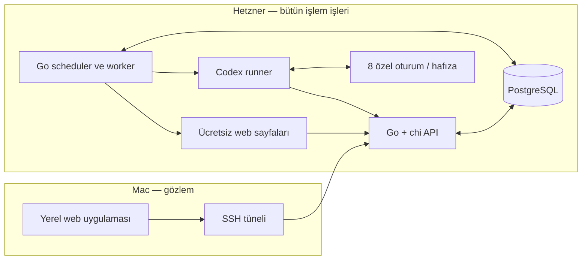

# Canlı Trading MVP — Uygulama ve Teknik Plan

Güncelleme: 12 Ekim 2026. Durum: ürün/mimari sözleşmesi ve ayrıntılı uygulama tasarımı yazıldı. Kullanıcı ChatGPT Pro aboneliğini, paylaşılan Hetzner sunucusunu ve root SSH erişimini doğruladı; model seçimini sonraya bıraktı. Salt okunur SSH/kapasite incelemesi yapıldı. Mac’te mevcut ChatGPT girişini kullanan iki paralel Codex oturumu, açık session ID ile devam ve üç kaynak okuma yöntemi gerçek çağrılarla sınandı (13. bölüm). Ardından sekiz ayrı oturumda, iki eşzamanlı worker ile 24 çağrılık tekrar denemesi tamamlandı (14. bölüm). 12 Ekim’de Hetzner’de ayrı trading kullanıcısıyla resmi Codex CLI 0.162.1 kuruldu; mevcut ChatGPT giriş kaydı resmî SSH alternatif yöntemiyle aktarıldı, gerçek model çağrısı ve aynı session’a devam doğrulandı (15. bölüm). Ürün backend kodu ve bütün trading deployment henüz kurulmadı. Uygulama ayrıntıları 12. bölümdedir. Gerçek abonelik bağlantısı, kimlik/oturum izolasyonu ve üç güncel fiyat kaynağının Hetzner'de çalışması kurulum kabul koşuludur. Bu koşullar geçmeden çalışan trading pilotu ilan edilmez.

Bu belge güncel teknik uygulama sözleşmesidir. Ürün kararları ve kaynak kapsamı [deney-plani.md](research/deney-plani.md) içindedir. Önceki beş belgenin değiştirilmeden korunmuş kopyaları [arşivdedir](research/archive-2026-10-08/MVP-TEKNIK-PLAN.md). Arşivdeki sayısal ETF/Python/API pilotu güncel MVP'nin gereksinimi değildir.

## 1. Son kapsam kararları

| Konu | Kesin kapsam |
|---|---|
| Ana ürün | Canlı ileriye dönük, sekiz ayrı sanal cüzdanın işlem yaptığı pilot A |
| Kategoriler | ABD hisseleri, QQQ, TQQQ, EWC |
| Cüzdanlar | ABD'de 3, QQQ'da 2, TQQQ'da 2, EWC'de 1; her biri 100.000 USD |
| Yetki | Kendi nakdiyle sahip olduğu hisse/ETF'yi al-sat; borç, faiz, margin, short ve türev yok |
| Serbestlik | Stratejik pozisyon/kayıp limiti, zorunlu nakit oranı veya tutma süresi yok |
| Model | Önce ChatGPT aboneliğiyle resmi Codex CLI; ayrı oturum ve özel hafıza |
| Veriler | Ücretsiz açık web araması/sayfa okuması; piyasa verisi API anahtarı ve ek veri aboneliği yok |
| Backend | Kendi Go + chi v5 uygulamamız; PostgreSQL |
| Yerleşim | Backend, PostgreSQL, model runner, hafıza ve bütün jobs Hetzner'de |
| Kullanıcı ekranı | Yalnız Mac'te çalışan yerel web uygulaması; Hetzner backendini okur |
| Değerlendirme | Benchmark, başarı skoru, yıllık %10 testi, model sıralama ve araştırma raporları şimdi yok |
| Sonraki ürünler | Tarihsel B, Gemini, gerçek broker ve gerçek para daha sonraki ayrı kapsam |
| Deney süresi | Sabit bitiş tarihi yok; Mac'in açık olması backendin çalışmasına şart değil |

1–4 numaralı kalan kararların tümünü kullanıcı asistana bıraktı. Aşağıdaki varsayılanlar bu yetkiyle seçilmiştir; tekrar teknik değer onayı aranmaz. Hedef sunucu IP'si aşağıda kayıtlıdır; SSH kullanıcı, port ve anahtar uygunluğu kurulum sırasında doğrulanır.

## 2. Hetzner ve Mac yerleşimi

**Geliştirme ve çalışma ortamı: Hetzner, hedef IP: `167.235.158.118`.** Backend, model bağlantıları, veri toplama ve sunucu testleri bu uzaktaki ortamda geliştirilip çalıştırılır. Mac yerel web gözlem uygulaması, kaynak dosyalarının düzenlenmesi ve uzak ortama erişim için kullanılır. Kullanıcının 9 Ekim açıklamasıyla ilk GPT abonelik/oturum denemesi Mac’teki mevcut giriş üzerinden yapıldı; bu geçici test üretim yerleşimini değiştirmez. Mevcut Hetzner sunucusuna kurulur; ancak kullanımda sorun çıkarsa başka sunucuya taşıma değerlendirilir.

**Hedef sunucu: `root@167.235.158.118`, SSH portu `22`.** 8 Ekim'de IP yerel kayıt/deploy ayarlarında bulundu. Kullanıcının 9 Ekim yetkisiyle mevcut Mac SSH kimliği kullanılarak BatchMode ve StrictHostKeyChecking açık halde salt okunur bağlantı başarılı oldu. Mevcut servislerde değişiklik yapılmadı. Root erişimi başlangıç envanteri/kurulum içindir; trading servisleri ve agent süreçleri ayrı yetkilerle çalışır.

9 Ekim envanteri: `immense-machine-v1`, Ubuntu 22.04.5 LTS, 4 vCPU, 7.747 MiB toplam RAM, kontrol anında 3.682 MiB available RAM; swap yok. Ana diskte yaklaşık 45 GiB boş yer var. Docker 29.3.1 ve Compose v5.1.1 mevcut, çeşitli projelerin konteynerleri çalışıyor. Bu tek anlık kontrol yeni uygulamanın kapasite kabulü değildir. Host PATH'inde `codex` bulunmadı; başka proje/container içinde bulunmadığı sonucu çıkarılmaz. Başlangıç render concurrency'si paylaşılan kapasite nedeniyle 1 olarak seçildi.

Tek Hetzner sunucusunda Go HTTP servisi, worker/scheduler, PostgreSQL ve cüzdanlara özel Codex çalışma ortamları bulunur. Mevcut sunucu işletim sistemi ve kaynakları kurulumda okunur; sunucuyu sıfırlama veya yeni ücretli kaynak satın alma bu planın parçası değildir. Mevcut Linux dağıtımında container çalıştırma uygunsa Docker Compose ile dağıtım yapılır; sürümler kurulumda sabitlenir. [Docker Compose resmi belgesi](https://docs.docker.com/compose/). Yerel headless Chromium sadece kaynak sayfasının render gerektirdiği durumda çalışır. Ücretli veri servisi veya görünmeyen piyasa API'sine geçiş yapılmaz.

Mac tarafı sade HTML/CSS ve vanilla TypeScript web uygulamasıdır. Yerel frontend sunucusu yalnız 127.0.0.1'e bağlanır; /api isteklerini SSH tüneli üzerinden Hetzner'deki kendi Go API'mize proxy eder. Bu yerel servis statik dosya sunumu/proxy dışında cüzdan muhasebesi, model bağlantısı veya zamanlayıcı çalıştırmaz. [Vite](https://vite.dev/guide/) frontend geliştirmesinde kullanılır; üretim kullanımında aynı yerel dosya/proxy sözleşmesi korunur.

Backend HTTP portu ilk sürümde sunucu localhost'una bağlıdır; veritabanı internete açılmaz. Mac–Hetzner ulaşımı SSH tüneliyle sağlanır. Model/worker iç erişimi cüzdana bağlı yetkiyle yapılır; kullanıcı oturumu ayrı kimliktir. Mac kapanınca görüntüleme kesilir; server jobs çalışır. Model kimlik bilgileri Mac frontendine gönderilmez. Public domain, internetten açık dashboard ve TLS reverse proxy bu özel ilk kurulumun zorunluluğu değildir.



chi sadece HTTP yönlendirme ve middleware katmanıdır; hazır trading motoru değildir. Emir, gerçekleşme, muhasebe, oturum yürütme ve kendi API'miz Go ile yazılır. Kaynak: [chi resmi proje belgesi](https://github.com/go-chi/chi).

## 3. Veri hattı ve fiyat kaynakları

### 3.1. Edinim

Model canlı web aramasıyla belge/sayfayı bulur ve okunabilen olguları kaynaklarıyla çıkarır. Emir öncesi fiyat, Go worker'ın seçili açık ürün sayfalarını yeniden okumasıyla doğrulanır. Gerektiğinde sunucudaki headless tarayıcı görünen sayfayı render eder. Kaynak okuyucusu kaynağa özel alanları çıkartır; doğrulamayı Go yapar. Arama özeti, model hafızası, sayfanın HTTP Date başlığı veya sayfanın yeni açılmış olması fiyat olay zamanını ispatlamaz.

Bir veri API anahtarı kullanılmaz; halka açık sayfa okuma, kullanıcı seçtiği ücretsiz web yönteminin içindedir. Gizli quote API'lerini tersine çevirme, erişim engeli/CAPTCHA aşma veya yeni veri hesabı açma bu planın yöntemleri değildir. Kaynakta gerekli alan görünmüyorsa eksik kalır.

### 3.2. Seçilen kaynak havuzu

Sıra: **Stock Analysis → Yahoo Finance → Webull**. **Nasdaq** teknik erişimi/güncelliği geçerse yedektir. Nasdaq varsayılan zorunlu üçüncü kaynak olmaktan çıkarıldı; 8 Ekim kontrolde sayfa fiyat vermedi. Webull yeni ücretsiz erişim adayıdır. Bir sembolde önce metadata/zaman/erişim koşullarını geçen ilk üç site seçilir; fiyatları daha çok uyuşan üçlü sonradan aranmaz. Üçlüde fark koşulu geçmezse tamamı yeniden kontrol edilir; yalnız aykırı fiyat diye kaynak çıkarılmaz.

| Ürün | Stock Analysis | Yahoo | Webull |
|---|---|---|---|
| ABD hissesi | /stocks/{site-slug}/ | /quote/{alias}/ | /quote/{exchange-symbol-slug} |
| QQQ | https://stockanalysis.com/etf/qqq/ | https://finance.yahoo.com/quote/QQQ/ | https://www.webull.com/quote/nasdaq-qqq |
| TQQQ | https://stockanalysis.com/etf/tqqq/ | https://finance.yahoo.com/quote/TQQQ/ | https://www.webull.com/quote/nasdaq-tqqq |
| EWC | https://stockanalysis.com/etf/ewc/ | https://finance.yahoo.com/quote/EWC/ | https://www.webull.com/quote/nysearca-ewc |

Hisse site URL'leri sabit sembol dönüştürme varsayımıyla üretilmez; varlık–kaynak alias haritası gerçek ürün sayfasıyla kurulur. BRK.B gibi hisse sınıfları tek kalıcı asset ID altında korunur.

8 Ekim 2026, yaklaşık 03:06 UTC kontrolünde ABD normal seansı kapalıydı. Stock Analysis QQQ fiyat/seans zamanı gösterdi. Webull QQQ, TQQQ, EWC ve AAPL sayfaları okunabildi; düzenli fiyatın ayrı güncel zaman damgası sayfa metninde tam kanıtlanmadı. Yahoo QQQ isteği 429 verdi. Nasdaq QQQ fiyatı kullanılamıyordu. Bunlar Hetzner erişim veya canlı üçlü kabul testi değildir. Webull'un ücretsiz Nasdaq Basic paketi hesabındaki kullanıcı erişimine ilişkin belgesidir; public sayfanın login olmadan aynı alanları sunduğunu garanti etmez.

9 Ekim 07:49–07:57 UTC Mac denemesinde Stock Analysis/Webull modelin canlı web aracıyla okunabildi. Yahoo doğrudan açma ve siteye özel aramada hata verdi; normal Mac tarayıcısı → görünen metin → aynı model oturumu yöntemiyle okunabildi. Dört sembolün üç sitedeki kapanış değerleri aynıydı; Webull düzenli fiyat zaman damgası ve güncel BBO/miktar kanıtı eksik kaldı. Normal seans kapalı olduğundan canlı 60 saniye koşulu sınanmadı. Ayrıntılar 13. bölümde ve [test verisinde](research/gpt-abonelik-kaynak-test-2026-10-09.json).

Kaynaklar: [Stock Analysis güncelleme bilgisi](https://stockanalysis.com/help/faq/stock-price-data/), [QQQ sayfası ve feed açıklaması](https://stockanalysis.com/etf/qqq/), [Webull market data belgesi](https://www.webull.com/help/faq/126-What-market-data-is-available-on-Webull), [Webull QQQ](https://www.webull.com/quote/nasdaq-qqq), [Nasdaq QQQ](https://www.nasdaq.com/market-activity/etf/qqq).

Investing.com fiyat kaynağına eklenmedi: ürün sayfası fiyatı indicative olarak niteliyor ve veri kullanım/saklama için açık izin koşulu koyuyor. CNBC bu okuma yolunda robots engeli verdi; Seeking Alpha sayfası uygun canlı fiyat alanını kanıtlamadı. Ücretsiz site etiketi otomatik kullanım hakkı veya fiyat güncelliği kanıtı değildir. Kaynak bazında kullanılabilir yöntem kurulumda kaydedilir; açık kısıtla uyuşmayan yol kullanılmaz. Investing/Trading Economics takvimleri yalnız kaynak keşfinde adaydır; backend değer saklama yolu otomatik onaylanmış değildir. Resmi olay takvimleri ve birincil sonuç belgeleri önceliklidir. [Investing.com ürün sayfası açıklaması](https://www.investing.com/etfs/powershares-qqqq).

### 3.3. Değişmeyen emir fiyatı koşulları

- Üç farklı sitede aynı asset ID/sınıf, USD, aynı normal seans ve son işlem fiyat türü.
- Her kayıt sonlu/pozitif; olay zamanı kontrol sonunda en fazla 60 saniye eski.
- En yeni/en eski olay zamanları en fazla 60 saniye ayrı; gelecek zaman kabul edilmez.
- 100 × (max − min) / median en fazla %1; tam %1 geçer.
- Üç site aynı feed kullanabilir; sitelerin uyumu üç bağımsız piyasa feed'i diye sunulmaz.
- 15 dakika gecikmiş fiyat, kapanış/NAV/after-hours fiyatı normal seans canlı fiyatı yerine geçmez.
- Koşullar geçmiyorsa price_unverified. Üçü ikiye indirme, eşiği büyütme veya geriye fill yazma yok.
- Emir kararı sonrası fiyat tekrar okunur. Doğrulanmış fiyat da gerçekleşebilir likiditeyi tek başına kanıtlamaz.

Piyasa kapalıyken aynı seansın resmi/kanıtlı kapanışları araştırma ve değerleme için kullanılabilir; o sırada işlem gerçekleşmez. Kaynak değişiklikleri sürümlenir.

### 3.4. Veri çekme aşamasında kaynak testi

Kullanıcının 8 Ekim yönlendirmesiyle bu kontrol **veri çekme prototipi geliştirilirken, bütün backend/emir/hafıza/ekran yapısının bitmesi beklenmeden** yapılır. Küçük kaynak okuyucuları Hetzner'de denenir; fiyatın güncelliği ve likidite alanları burada ölçülür. Eksik kaynağın okuyucusu veya kaynak seçimi bu aşamada güncellenip tekrar denenir. Genel yapının tamamlanmasından sonraya bırakılan ayrı bir kaynak sınavı değildir.

Hetzner'de normal seans içinde QQQ, TQQQ, EWC ve sabit listeden AAPL, JPM, XOM, BRK.B için ilk oturumdan ve kapanış öncesi oturumdan örnekler alınır. Seçilen üç site aynı döngüde kimlik, tür, kaynak olay zamanı ve fark koşullarını geçmelidir. Aktif emirli her ek sembolün aynı koşulu kendi başına geçmesi şarttır; örnek test tüm evreni kanıtlamaz.

Bu koşul başarısızsa erişilebilen sayfalarla veri toplama ve gözlem çalışabilir; sanal alış/satış gerçekleşmesi etkinleştirilmez. Mevcut ücretsiz koşullarla bunu garanti eden üçlü henüz kanıtlanmadı. Bu açık bir kurulum sonucu, tamamlanmamış kullanıcı kararı değildir; başarılı test varmış gibi gösterilmeyecek.

## 4. Emir ve gerçekleşme sözleşmesi

### 4.1. Araçlar ve emir ömrü

Başlangıçta hisse/ETF emirleri tam pay adediyle verilir. Fractional share, opsiyon, short, margin ve ödünç yok. USD cash hesabı; her cüzdanın alış evreni kendi kategorisiyle sınırlandırılır. Dinamik listeden çıkan eldeki pay satılabilir; gerçekleşmemiş yeni alış emirleri liste değişiminde iptal edilir.

| Tür | Çalışma kuralı | Ömür |
|---|---|---|
| MARKET | Bir sonraki uygun canlı kanıtta mevcut karşı taraf fiyatıyla maliyet dahil gerçekleşme denenir | En fazla 120 saniye; seans bitince daha erken sona erer |
| LIMIT | Alış gerçekleşme fiyatı ≤ limit, satış fiyatı ≥ limit | Varsayılan DAY; model GTC seçebilir |
| STOP_MARKET | Doğrulanmış last stop seviyesini geçince MARKET'e dönüşür; stop fiyatından fill garantisi yok | DAY veya GTC; trigger sonrası market 120 saniye |
| STOP_LIMIT | Stop tetiklenince limit emri çalışır; fiyat limit dışındaysa bekler | DAY veya GTC |
| CANCEL / REPLACE | Yalnız kendi açık emri; replace eski emri iptal edip yeni sürüm yaratır | Gerçekleşmiş miktar geri alınmaz |

DAY normal seans kapanışında sona erer. GTC broker simülasyonu tercihi olarak 90 takvim günü sonra, ilgili normal seans sonunda sona erer; model sonraki rutin oturumlarda yenileyebilir. Bu süre pozisyon tutma zorunluluğu veya zorunlu satış değildir. Seans dışı gerçekleşme yok. Bekleyen GTC emirleri sonraki normal seansa taşınır; açılış boşluğu yeni fiyattan değerlendirilir.

Satış tarafında take-profit limit ve stop emri aynı OCO grubuna bağlanabilir. Grup pozisyonu bir kez rezerve eder; toplam kalan grup miktarı sahip olunan payı aşmaz. Bir kolun kısmi gerçekleşmesi diğerinin miktarını azaltır, tam gerçekleşme diğerini iptal eder. Aynı pay bağımsız ikinci emirde yeniden rezerve edilmez.

### 4.2. Fiyat ve likidite

Üç son işlem fiyatı kontrolünün ardından **zamanı ve kapsamı kanıtlı güncel bid/ask ve karşı taraf miktarı** gerekir. Buy ask'tan, sell bid'den başlar. Bu kotasyonun NBBO olduğu kanıtlanmamışsa NBBO olarak etiketlenmez; kısmi venue feed'i olduğu yazılır. Bid/ask zamanı da en fazla 60 saniye eski olmalıdır. Bid ≤ ask, pozitif miktar ve miktar birimi şarttır. Halt veya bozuk/eksik kotasyonda gerçekleşme yok.

Kayma için tüm cüzdanlarda aynı açık simülatör varsayımı **aleyhte 5 baz puandır (%0,05)**:
- alış: ask × 1,0005, izinli fiyat adımına yukarı yuvarlama;
- satış: bid × 0,9995, izinli fiyat adımına aşağı yuvarlama.

Spread bid/ask farkıyla zaten işlenir; ikinci bir spread bedeli çıkarılmaz. Bu kayma gerçek fill gözlemi değil, muhafazakâr V1 model varsayımıdır. Kaynak, ham bid/ask, zaman, miktar, fiyat adımı ve maliyet model sürümü saklanır. Gerçek broker emri veya gerçek karşı taraf gerçekleşmesi iddia edilmez. Üç fiyatın median'ı değerleme/trigger referansı olabilir; otomatik fill fiyatı değildir.

Bir gözlemde fill miktarı kalan emir, güncel gösterilen karşı taraf miktarı ve cüzdanın kullanılabilir nakit/payının izin verdiği miktarın küçüğüdür. Karşı taraf miktarı bilinmiyorsa sıfır kapasite; hacim varmış gibi varsayım yapılmaz. Aynı quote ID'deki miktar aynı cüzdanda yeniden tüketilmez. Karşılaştırılabilir feed ve seansla bir dakikalık hacim kanıtı varsa o dakika cüzdan başına o sembolde hacmin en fazla %1'i tüketilir; bu pozisyon risk limiti değildir. Hacim bilinmiyorsa görülen quote miktarı aşılmaz. Her cüzdan bağımsız sanal hesap olarak aynı piyasa kanıtını kullanır; öteki cüzdanın emri kapasitesinden düşülmez.

Limit/stop tetiklemesi yalnız emirden sonra gözlenen uygun snapshotta yapılır. İki kontrol arasındaki hayali en iyi fiyat veya günlük high/low ile geriye gerçekleşme yazılmaz. MARKET kalan miktarı 120 saniyede iptal olur; limit/GTC kalan miktarı yaşamaya devam eder. Miktar ve nakit rezervleri her kısmi fill/iptalde atomik güncellenir. Likidite/veri kanıtı yoksa emir bekleyebilir veya ömrü dolabilir; bütün emirlerin dolacağı taahhüt edilmez.

### 4.3. Nakit, muhasebe ve takas

Her alış emri toplam maliyet dahil **cash_budget_usd** bildirir; kendi ayrılmamış kullanılabilir nakdi kadar bütçe ayırabilir. Limit fiyat ve miktar için gerekenden düşük bütçe kabul edilmez. Gelecek fiyat bütçeyi aşarsa borç yaratılmaz; izin verilen kısmi miktar gerçekleştirilir veya emir yetersiz nakit durumuna girer. Satış yalnız eldeki ve başka emre ayrılmamış miktardır.

V1 broker hesabı **yalnız takası tamamlanmış nakitle alış** yapar. Başlangıç 100.000 USD bu durumdadır. Alışta para ve masraf rezerve edilir/harcanır, pay pozisyonda görünür; bu parayla finanse edilmiş pay aynı gün satılabilir. Satışın net geliri takas alacağına geçer; ilgili ABD menkul kıymet takas takviminde T+1 günü settled nakde dönüşür. Borsa işlem takvimi ile bankacılık/takas tatilleri ayrı tutulur; yalnız sonraki borsa günü eklemek yeterli değildir. Takas takvimi doğrulanmadan takası bekleyen para serbest bırakılmaz.

Bu seçim cash broker'ın daha geniş unsettled-proceeds kullanımından bilinçli olarak dardır; kullanıcıya yanlış sınırsız gün içi satın alma gücü göstermez. Belirli bir gerçek brokerın tüm cash hesabı davranışını kopyaladığı iddia edilmez. [SEC cash hesabı örnekleri](https://www.investor.gov/introduction-investing/general-resources/news-alerts/alerts-bulletins/investor-bulletins/updated-9), [T+1 bülteni](https://www.investor.gov/introduction-investing/general-resources/news-alerts/alerts-bulletins/investor-bulletins/new-t1-settlement-cycle-what-investors-need-know-investor-bulletin).

Para ve miktarlar decimal/sabit noktalıdır. Ledger çift taraflı ve değiştirilemez para hareketlerini tutar; hata düzeltmesi ters kayıt/yeni kayıt yaratır. Pozisyon maliyet tabanı FIFO lotları ve alış masrafıyla izlenir; satış masrafı satış sonucuna girer. Masraf iki kez çıkarılmaz. Görüntülenen özkaynak settled+reserved nakit, unsettled alacaklar, pozisyon değeri ve temettü alacaklarından, diğer tahakkuk borçlarının çıkarılmasıdır. Rezerv nakit toplam varlığa ikinci kez eklenmez.

### 4.4. Broker maliyetleri ve dağıtım

Komisyon profili **IBKR Pro Fixed referanslı sanal USD cash hesabı**; gerçek broker bağlantısı değildir. Tam pay emrinin bir günlük toplam gerçekleşmesinde:
commission = min(max(0,005 USD × gerçekleşen pay, 1 USD), gerçekleşen tutarın %1'i).

Aynı emrin aynı günkü kısmi gerçekleşmeleri minimumu tekrar tekrar yaratmaz; toplam gerçekleşme arttıkça kümülatif komisyonun yalnız farkı kesilir. Sonraki gün gerçekleşmesi yeni günlük minimum dilimidir; cancel-replace ayrı emirdir. Gerçekleşmeyen emirden komisyon alınmaz.

Regulatory fee tablosu geçerlilik tarihleriyle saklanır. 8 Ekim kaynak kontrolünde IBKR sayfası SEC satış ücretini 0,0000206 × satış tutarı; CAT ücretini 0,000003 × gerçekleşen pay; TAF'ı 0 olarak gösterdi. TAF'ın sıfır dönemi **1 Ekim–31 Aralık 2026** ile sınırlıdır. Bu tablo geleceğe süresiz taşınmaz. Yeni geçerlilik dönemi öncesi broker/resmi kaynak tekrar okunup sürümlenir; ücret kapsamı bilinmiyorsa o dönemde gerçekleşme bekletilir. Fixed fiyatın içine alınan clearing/exchange ücretleri ayrıca ikinci kez kesilmez. Tam cent tahakkuklar günlük broker profiline göre yukarı yuvarlanır, kısmi filllerde önceki tahakkukun farkı işlenir; yuvarlama V1 yaklaşımı ayrıca kaydedilir. Kaynaklar: [IBKR maliyet tablosu](https://www.interactivebrokers.com/en/pricing/commissions-stocks.php), [SEC'de geçici TAF durdurma bildirimi](https://www.sec.gov/files/rules/sro/finra/2026/34-106409.pdf).

Temettüde ex-date öncesi hak sahibi pay adedi dondurulur; ex-date günü alım hak yaratmaz. Hak net/brüt/stopaj olarak alacağa yazılır, ödeme tarihinde nakde çevrilir; tekrar sayılmaz ve otomatik yeniden yatırılmaz. T+1 istisnası, due-bill veya özel kurumsal olayda resmi olay sözleşmesi esas alınır. Bölünmeler pay adedi, lot maliyeti ve açık emir miktar/fiyatlarını değiştiren sürümlü olaydır. Birleşme/delist/spin-off ve fractional cash-in-lieu, resmi şartı bulunmadığında çözülmemiş olay olarak kalır; uydurma nakit oluşturulmaz. Kaynak eksikse ilgili varlığın yeni gerçekleşmesi durur; geri kalan hesap çalışır.

Vergi profili için kullanıcının ikameti tahmin edilmez. V1 açık varsayımı: ABD dışı birey, anlaşma indirimi uygulanmayan **olağan ABD kaynaklı temettüde %30 stopaj**. Bu kullanıcının gerçek vergi oranı iddiası değildir. RIC/REIT dağıtım bileşenleri, sermaye iadesi veya özel dağıtım otomatik olağan temettü sayılmaz; belgeyle sınıflandırılır, eksikse brüt alacak ve çözülmemiş stopaj tutulur, net nakit serbest bırakılmaz. Sonradan kesin sınıflandırma düzeltme kaydı üretir. Kişisel gelir vergisi kapsam dışıdır. EWC'nin Kanada maruziyeti diye aynı dağıtıma bir Kanada vergisi daha otomatik eklenmez; fon fiyatına yansıyan gider/vergi tekrar kesilmez. [IRS NRA withholding](https://www.irs.gov/individuals/international-taxpayers/nra-withholding), [IRS specific income](https://www.irs.gov/individuals/international-taxpayers/federal-income-tax-withholding-and-reporting-on-other-kinds-of-us-source-income-paid-to-nonresident-aliens).

## 5. Takvim, kontrol sıklığı ve hata davranışı

Tüm zamanlar UTC saklanır; borsa karar takvimi America/New_York, ekran Europe/Istanbul'dur. Normal seans, tatil ve erken kapanış [NYSE takviminden](https://www.nyse.com/trade/hours-calendars) ve ilgili Nasdaq takviminden türetilir. Tarih/saat model hafızasından alınmaz.

| İş | V1 sıklık / zaman |
|---|---|
| İlk ortak araştırma ve cüzdan karar oturumu | Normal açılış +30 dakika |
| İkinci ortak araştırma ve cüzdan karar oturumu | Normal kapanış −60 dakika |
| Dinamik 20 liste seçimi | ABD haftasının ilk işlem günü 09:00 ET; ilk oturum başlamadan sürümleşir |
| Aktif koşullu emir fiyatı | Normal seansta, yalnız aktif emirli tekil semboller için 60 saniyede bir |
| MARKET yürütme denemesi | İlk deneme hemen; 120 saniyelik ömür içinde 30 saniye arayla, yeni uygun kanıt varsa |
| Elde tutulan pozisyon değerlemesi | Normal seansta 5 dakikada bir; son doğrulanmış değerin zamanı/kalitesi görünür |
| Planlı önemli olay öncesi | Açıklama −30 dakika: tarih/beklenti kontrolü |
| Planlı olay sonrası | +5 ve +15 dakika: resmi sonuç, doğrulama ve düzeltme kontrolü |
| Erişilemeyen olay sonucu | Son kontrolden +30 dakika sonra bir ek deneme; sonra eksik kayıt |
| Kapanış muhasebe/son değerleme | Normal kapanış +10 dakika, işlem vermeden |
| Mac ekran yenilemesi | Açıkken 15 saniyede bir mevcut backend kayıtları; yeni model çağrısı değildir |

Koşullu kontrol döngüleri aynı sembolde üst üste binmez. Dört kategorinin aynı ETF/hisse kaynak işi bir kez toplanır ve ham olgular paylaşılır. Bir dakikalık kontrol kesintisiz tick izleme değildir; arada geçen fiyat seviyesinden geriye fill yapılmaz. Belirlenmemiş bir olayın zamanını model tamamlamaz. Saati bilinmeyen bilanço yalnız takvim teyidi olarak kalır; resmi yayın yeni rutin taramada görülünce olay kaydı oluşur. Plan dışı haber görüldüğünde ilgili olgu kontrolü yapılır; 24 saat kesintisiz haber takibi taahhüdü yok.

Ek olay işleri veri günceller; yeni cüzdan model kararı veya üçüncü işlem oturumu oluşturmaz. Mevcut koşullu emirler kendi fiyat koşullarıyla çalışmaya devam eder. Seans dışı olay bilgisi kaydedilebilir, emir gerçekleşmez. Yaklaşan planlı olay takvimi her rutin taramada güncellenir; sonradan görülmüş beklenti açıklama öncesi snapshot diye yazılmaz.

Kaynak sayfası için normal HTTP timeout 12 saniye, render gerektiren sayfa için 25 saniye; bir üçlü fiyat turunun bütçesi 45 saniyedir. Site okumaları bağımsız olarak paralel yapılır, kaynağın hız sınırı gözetilir. Timeout eski fiyatı güncellemez. Geçici hata retry süreleri 15, 45 ve 120 saniyedir; order TTL veya oturum deadline daha erkense retry yapılmaz. 429 Retry-After varsa ona uyulur. Aynı sitede üç ardışık erişim hatasında beş dakika bekleme uygulanır; bu sürede yedek sadece uygun kayıt sağlıyorsa kullanılabilir. Auth/kota hatası otomatik gerçek para işlemine veya ücretli API'ye geçiş yaratmaz; hesap durumu görünür.

Rutin ortak veri işi için 5 dakika, cüzdan işi için çağrı başına 6 dakika ve doğrulama/tek onarım dahil en fazla 10 dakika bütçe vardır. İki worker ve sekiz cüzdan için oturum toplam son zamanı başlangıç +45 dakika ile normal seans kapanışının erken olanıdır. Zaman aşan tur failed/late olur; üçüncü oturumda telafi veya eski saate karar yazma yok. Yalnız tam geçerli, süresi içinde ulaşan yapılandırılmış çıktı emre çevrilir. Hatalı JSON için bir kez 60 saniyelik biçim onarımı yapılabilir; yeni işlem fikri istenmez ve global deadline korunur.

Kaçırılmış karar işi sonraki normal oturumda yeni veriyle devam eder; geçmişe işlem yazılmaz. Worker yeniden başlaması tamamlanmış karar veya fill'i yeniden üretmez. Kabul edilmiş emir kaybında yeni emir istemeden backend durumu okunur.

## 6. GPT bağlantısı ve özel hafıza

### 6.1. Resmi abonelik bağlantısı

Hetzner'de resmi Codex CLI, mevcut ChatGPT Pro abonelik kimliğiyle çalışır. Kullanıcı 9 Ekim'de mevcut aboneliğin kullanılmasını ve model seçiminin sonraya bırakılmasını istedi; abonelik yükseltmesi/kota tercihi yeniden sorulmaz. Headless device-code girişi tercih edilen yoldur: link/kod sunucuda üretilir, kullanıcı Mac tarayıcısında tamamlar. 12 Ekim’de bu akış başlatıldı; tarayıcı yeniden giriş istediği için bekleyen işlem durduruldu ve resmî alternatifle Mac’teki mevcut Codex auth cache, SSH üzerinden sunucuya aktarıldı. Login status ve iki gerçek çağrı başarılı oldu (15. bölüm). Device-code onayı tamamlanmış sayılmaz; giriş cache aktarımıyla sağlandı. Kaynak: [resmi kimlik doğrulama / headless login](https://learn.chatgpt.com/docs/auth).

9 Ekim Mac prototipinde mevcut ChatGPT girişi API anahtarı olmadan gerçek model çağrılarıyla çalıştı. İki ayrı `CODEX_HOME` ve workspace, iki paralel başlangıç ve açık session ID ile devam sınandı. Bu sonuç Hetzner girişini veya bütün OS/API izolasyonunu kanıtlamaz; gerçek deneme 13. bölümdedir.

Go runner CLI'yi doğrudan süreç olarak çalıştırır; prompt stdin ile verilir, JSONL olaylar okunur. İlk thread.started kimliği wallet_id ile eşlenir; sonraki çalışmalarda açık session ID ile resume yapılır. Ortak --last kullanılmaz. Geçerli JSON kararına kendi Go API'miz üzerinden emir gönderilir, backend makbuzu aynı oturuma geri verilir. İş/sonuç/sessiyon bağlantısı transaction ile kaydedilir. Yetkilendirme modelin metinde yazdığı wallet_id'ye güvenmez. [CLI otomasyon, JSONL ve resume](https://learn.chatgpt.com/docs/non-interactive-mode).

Başlangıçta **2 paralel cüzdan worker'ı** seçildi; sayı config ile değişebilir. Aynı cüzdanda tek aktif writer vardır. Sekiz oturum tek hesabın kullanım hakkını paylaşır; gerçek eşzamanlı kapasite kurulumda ölçülür. Aynı temel model, CLI/config sürümü ve reasoning ayarı sekiz cüzdanda ortak kaydedilir. Model ID kullanıcıyla daha sonra seçilip pilot başlamadan sabitlenir; ilk bağlantı prototipindeki geçici model bunun nihai seçimi değildir ve kaydedilir. Sessiz otomatik başka modele geçiş yok. Gemini/OpenRouter/Claude ile retry yapılmaz.

Canlı arama modu açıkça ayarlanır; cached sonuç fiyat güncelliği kanıtı değildir. Web metni veri olarak değerlendirilir; sayfadaki talimat hesap/karakter/araç yetkisini değiştiremez. [Canlı web araması ve ağ ayrımı](https://learn.chatgpt.com/docs/web-search).

### 6.2. Bellek ve izolasyon

Backendde her cüzdan için sabit persona sürümü, tüm yayımlanan karar/girdi/makbuz geçmişi, kendi araştırma notları, sürümlü özet ve açık session ID bulunur. Model ağırlıkları, erişilemeyen iç düşünce veya genel ChatGPT kişisel hafızası saklama iddiası yoktur. Her turda bakiye/pozisyon/açık emir backendden yeniden alınır; geçmiş özetinden hesaplanmaz.

Her cüzdanın ayrı process/workspace, CLI oturum deposu ve özel not alanı bulunur. Diğer cüzdan dizinleri ve genel kullanıcı ChatGPT/Codex geçmişi modelin araçlarıyla okunamaz. Paylaşılan filesystem kökünü sadece klasör adıyla ayırmak yeterli değildir; mount/OS erişimi de ayrılır. Kullanıcının ev dizini, repo plan belgeleri, yönetici DB sırları ve deney metadatası model ortamına konulmaz. Model kendi cüzdanına yetkili API uçlarına ve ortak kanıt deposuna erişir; list-all-wallets veya yönetici ucu yoktur.

Auth bilgileri yalnız trusted runner tarafından yönetilir; agent araçları okuyamaz. Ortak credentials'ın eşzamanlı yenilenmesi tek yönetilen auth bağlamında koordine edilir; her agent'a denetimsiz yazılabilir ortak auth/session dizini verilmez.

Hafıza modülü yazılırken küçük bir işlev kontrolü yapılır: A ve B cüzdanlarının kayıtlarına farklı örnek notlar konur; aynı anda devam eden iki oturumun doğru kendi not/session'ını aldığı ve A kimliğiyle B'nin kayıt/dosyasını okuma isteğinin reddedildiği doğrulanır. Bu, ayrı kapsamlı bir test projesi veya uzun deney değildir; özel hafıza ve erişim yetkilerinin doğru bağlandığını denetleyen normal geliştirme kontrolüdür. Yalnız farklı session ID/klasör kullanılması doğru yönlendirme ve yetkilendirmeyi kendiliğinden kanıtlamaz. Hata çıkarsa ilgili modül düzeltilir; diğer bağımsız geliştirme işleri devam edebilir.

Özet çalışma bağlamı en fazla 12.000 karakterdir; uzun tam geçmiş ilgili kayıt kimliğiyle ayrı erişilebilir. Her yeni turun sonunda model kendi tez/not güncellemesini verir; kaynak, zaman ve kayıt ilişkisi doğrulanıp yeni özet sürümü oluşur. Çelişkili yeni not eski kararın yerine yazılmaz. Özet başarısızsa son geçerli özet ve yeni tamamlanmış kayıtlar korunur.

CLI rollout dosyası da özel persistent volume'da tutulur; DB'deki session ID tek başına tam oturum yedeği değildir. Oturum kaybında yeni session kendi persona/geçmiş/özetiyle başlatılır; eski/yeni bağlantı ve neden kaydedilir. Birebir aynı bağlamın geri geldiği iddia edilmez.

## 7. Kesin model talimatları ve karar alanları

Modelin göreceği talimat ve persona metinleri [deney planının model sözleşmesinde](research/deney-plani.md#7-model-talimatları) tam olarak tanımlıdır. Kullanıcıya ait simülasyon/değerlendirme açıklamaları model payload'ına konulmaz.

### 7.1. Girdi

Her turun girdisi: wallet-local hesap kimliği, gerçek UTC/ET zaman, seans ve kalan süre, persona sürümü, izinli varlık listesi/sürümü, settled/reserved/unsettled cash, kendi pozisyonları ve maliyetleri, açık emir/OCO rezervleri, en son emir makbuzları, kendi not özeti ve erişilebilir kanıt paketi. Ortak paket event/source/price ID'lerini, observed_at ve validasyon durumunu taşır. Veri eksikleri ve çelişkiler görünür. Portföy veya nakit modelden tahmin edilmesi istenen bilgi değildir.

### 7.2. Çıktı sözleşmesi

JSON Schema sürümü v1, unknown alanlar reddedilir. Para/fiyat değerleri decimal string, quantities pozitif tam sayıdır. Wallet kimliği server-side scoped olur. Run/decision ID runner tarafından üretilir; model değiştiremez.

| Alan | Kural |
|---|---|
| action | HOLD, SUBMIT, CANCEL, REPLACE |
| client_action_id | Tur içinde benzersiz; runner kalıcı decision ID ile idempotency key üretir |
| asset_id / side / quantity | SUBMIT/REPLACE için gerekli; canonical varlık, BUY/SELL, pozitif tam miktar |
| order_type / time_in_force | MARKET, LIMIT, STOP_MARKET, STOP_LIMIT; DAY/GTC uygunluğu backendde doğrulanır |
| limit_price / stop_price | Tür gerektiriyorsa pozitif decimal; diğer türde null |
| cash_budget_usd | BUY için toplam masraf dahil ayrılacak tutar; SELL için null |
| target_order_id | CANCEL/REPLACE için yalnız kendi açık emri |
| oco_group_id | İsteğe bağlı, kendi satış grubuna ait; server-side miktar denetimi |
| thesis / evidence_ids | İşlem gerekçesi ve gerçekten görülen kaynak kayıtları; olmayan ID ret |
| evidence_status | İki kaynak / tek kaynak / çelişki / eksik; yorum doğrulanmış olgu diye sunulmaz |
| expected_catalyst / exit_condition | Modelin kendi beklentisi ve tezin geçersizleşme koşulu; zorunlu tutma süresi oluşturmaz |
| memory_update | Kendi yeni tez/izleme/öğrenme notları; yorum ve olgu ayrılmış |
| hold_reason | HOLD için gerekçe; HOLD geçerli karar, işlem zorunluluğu yok |

Bir tur birden fazla kendi emir eylemi içerebilir; backend belirtilen sırayla ve her eylemi ayrı atomic işlem olarak uygular. Önceki eylem sonucu sonraki eylemin varsayımını bozarsa dependent_action_blocked kaydı döner. Market satışının unsettled gelirini aynı turda yeni alış bütçesi saymak yok. Sonuçtan sonra yeni stratejik batch istenmez; aynı turda yalnız teslim edilen batchin receipt/biçim uzlaşımı tamamlanır. Koşullu emirlerin sonraki sonuçları bir sonraki rutin turda modele aktarılır.

Backend receipt alanları: order_id, action sonucu, accepted/waiting/partially_filled/filled/rejected/cancelled/expired durumları, gerçekleşen/kalan miktar, fill fiyatı, masraf kalemleri, fill zamanı, kaynak/validation ID ve kendi güncel cash/position durumudur. Kabul edilen emir gerçekleşmiş gibi yanıtlanmaz. Kullanıcıya ait paper/cost-model metadata agent receipt'ine eklenmez; fiyat/sonuç sayıları yine backend kaydıyla doğru olur.

## 8. Backend veri modeli ve API

PostgreSQL birincil kaynaktır. Go uygulaması modülleri: assets/universe, shared-evidence, wallet-ledger, orders/execution, corporate-actions/settlement, jobs, model-runner, private-memory, operator-read-model.

Ortak tablolar: assets, source_aliases, universe_versions/members, documents/claims/events, price_observations/validations, execution_quotes, market/settlement_calendars ve cost_profile_versions.
Özel tablolar: wallets, cash_ledger_entries, tax/dividend_receivables, position_lots, orders/order_events/fills, reservations/oco_groups, decision_runs/actions/receipts, wallet_sessions, memory_versions/notes.
Operasyon tabloları: jobs/leases, source_health, auth_status, audit_events ve backup_manifests.

Tüm özel kayıtların wallet_id'si zorunludur; foreign key ve wallet-scope tutarlılığı kontrol edilir. API scoped kimlikten wallet_id türetir. HTTP gövdesindeki değiştirilmiş kimlik erişim sağlamaz. Model DB'ye doğrudan erişmez.

Kendi API yolları:
- agent: GET /agent/account, /agent/positions, /agent/orders, /agent/memory, /agent/evidence/{id}; POST /agent/order-actions.
- operator: GET /operator/wallets, /operator/wallets/{id}, /operator/orders, /operator/evidence, /operator/system-status.
- /healthz ve /readyz teknik servis durumu.
Operator yazma/emir/para aktarma ekranı MVP'ye eklenmez.

Emir idempotency key'i account+decision+action üzerinden benzersizdir. Kabul edilen eylem tekrarında aynı sonuç okunur; farklı gövdeyle aynı anahtar conflict'tir. Cüzdan satırı/rezervler transaction içinde kilitlenir, fill+lot+ledger+order event birlikte commit edilir. [PostgreSQL satır kilitleri](https://www.postgresql.org/docs/current/explicit-locking.html).

Jobs PG'de kalıcı ve lease'li tutulur; işi alan worker fencing/version anahtarıyla sonuç yazar. Worker ölürse lease dolunca incomplete iş alınır; stale worker'ın ikinci sonucu reddedilir. Dış çağrı ile DB commit arasında exactly-once garanti varsayılmaz; durable intent, reconciliation ve idempotent emir sonucu gerekir. Tüm tahakkuk/settlement/corporate-action jobs da olay kimliğiyle benzersizdir. İş restartı geçen fiyat tetiklemesini geriye üretmez.

## 9. Mac gözlem ekranı ve saklama

Ana sayfa: sekiz cüzdan, özkaynak, settled kullanılabilir nakit, rezerve nakit, unsettled alacak, pozisyon değeri ve başlangıca göre parasal/yüzdesel değişim. Detail: varlık miktarı/maliyeti, açık ve gerçekleşen emirler, masraflar, gerekçe, kanıt linkleri, kendi geçmişi ve son fiyat zamanı. Eksik fiyat varsa son bilinen değer stale etiketiyle gösterilir; veri yokluğu sıfır fiyat değildir.

Sistem paneli yalnız operasyon için kaynak erişimi, job/auth hataları ve son başarılı kontrolü gösterir. Benchmark, Sharpe, yıllık başarı testi, cüzdan sıralaması, otomatik başarı değerlendirmesi veya deney skorlaması yoktur. Kullanıcı ekranında cüzdanların sanal olduğu açık yazılır. Model bu kullanıcı ekranına erişmez.

Ledger/emir/fill/karar/hafıza sürümleri pilot boyunca korunur. Karara/gerçekleşmeye bağlı fiyat/kanıt kayıtları da korunur. Diğer yüksek frekanslı quote kayıtları 30 gün, teknik debug logları 14 gün saklanır; auth sırları loglanmaz. Tam haber gövdesi varsayılan arşivlenmez; URL, menşe, okunmuş alanlar, kısa destekleyici metin, erişim zamanı ve bu kanıt paketinin hash'i tutulur. Hash bütün sayfa sürümünün arşivlendiği iddiası değildir. Kaynağın açık saklama kısıtı varsa paket kapsamı ona göre daraltılır veya kaynak yolu kullanılmaz.

Gecelik encrypted DB+özel rollout/konfigürasyon yedeği sunucuda 7 günlük ve 4 haftalık döngüyle korunur. Mac açıksa SSH üzerinden en yeni encrypted yedek kopyası senkronize edilir; ayrı snapshotlar da kendi manifestiyle izlenir. Tek sunucudaki yedek tek başına host kaybına dayanıklı değildir; Mac'e ulaşan son yedeğin zamanı sistem panelinde görünür. Yeni ücretli backup ürünü satın alınmaz. Restore kabul testi kurulumun parçasıdır.

## 10. Geliştirme sırası ve kabul koşulları

| Sıra | Somut teslimat | Kabul |
|---|---|---|
| 1 | Hetzner erişim/OS incelemesi, resmi GPT abonelik runner denemesi | Gerçek giriş, JSONL/structured çıktı, aynı session devamı; sırlar agent araçlarından okunamaz |
| 2 | Veri çekme prototipi: küçük kaynak okuyucuları Hetzner'de | Bütün yapıyı beklemeden ücretsiz üçlü, zaman ve BBO/size alanları normal seansta sınanır; gerekli kaynak/okuyucu değişikliği burada yapılır |
| 3 | Go/chi, PostgreSQL migrations, sekiz wallet seed, ledger/reservations | Her biri 100.000 USD, sıfır pay; no overdraft, double spend veya transfer |
| 4 | Emir/state machine, maliyet/takas/kurumsal olay motoru | Limit/stop/OCO/partial, deadline, T+1, masraf ve idempotency muhasebesi tutarlı |
| 5 | Ortak research + 50/20 evren, event jobs, 2 günlük oturum ve fiyat worker | Takvim/DST/erken kapanış; eksik veri fill üretmez; Mac kapalıyken devam |
| 6 | Sekiz nihai persona, özel bellek ve receipt döngüsü | Modül içinde kısa iki-cüzdan kontrolü: doğru session/not yönlendirmesi, başka cüzdan kaydına erişimin reddi; karakter sabit, kendi notları sürümlü |
| 7 | Yerel Mac web gözlem uygulaması ve SSH/proxy | Veriler server kayıtlarıyla aynı; stale/hata zamanı görünür; model key yerelde yok |
| 8 | Restart/retry, restore ve bütünleşik normal seans kontrolü | Aynı emir çift fill olmaz; eski fiyat/kaçırılan trigger geçmişe yazılmaz |

Maliyet/takas/parasal transaction değişiklikleri için anlamlı otomatik testler gerekir; plan metni veya basit statik ekran değişikliği için sahte test yazılmaz. Bu tabloda kabul, yazılım doğruluğudur; yatırım başarısı değerlendirmesi değildir.

Plan aşamasında yapılmış işler: resmi belgelerin okunması, ücretsiz sayfa erişim kontrolü, kararların seçilmesi ve belgelerin revizyonu. 9 Ekim'de salt okunur sunucu erişim ve kapasite envanteri de yapıldı. Mac’te mevcut ChatGPT kimliğiyle iki paralel CLI oturumu, devam çağrıları ve üç kaynak okuma yöntemi de sınandı (13. bölüm). 12 Ekim’de Hetzner CLI kurulumu, mevcut ChatGPT giriş cache aktarımı, gerçek çağrı ve explicit resume da başarılı oldu (15. bölüm). Yapılmamış işler: Go runner/backend ve bütün trading kurulumu, DB seed, canlı normal seans üçlü/BBO testi veya sanal trade.

## 11. Son genel revizyon sonucu

- Eski 8 ETF sayısal pilot, Python/FastAPI, ücretli/anahtarlı fiyat API ve sabit 08:30 cutoff güncel MVP'den çıkarıldı.
- Kendi Go/chi backend, özel hafıza ve GPT runner Hetzner'e; basit frontend Mac'e yerleştirildi. Önceki server-side HTML ekran önerisi yerine yerel frontend seçildi.
- 50 sabit + haftalık 20 dinamik ABD hissesi ve 3+2+2+1 cüzdan yapısı korundu.
- Kaynak doğrulama ölçüsü üç site / %1 / 60 saniye olarak korundu; kaynak havuzuna Webull eklendi, Nasdaq yedek oldu.
- Emir türleri, varsayımsal kayma, referans komisyon, nakit/takas, conditional kontrol sıklığı ve nihai model sözleşmesi tamamlandı.
- Yıllık hedef, kıyaslar ve başarı değerlendirmesi kullanıcı kararıyla sonraya bırakıldı; bakiye/işlem gözlemi korundu.
- Fiyat/likidite testi veri çekme prototipi aşamasına yerleştirildi; bütün yapı tamamlanana kadar beklenmez. Hafıza ayrılığı kendi modülü içinde kısa işlev/yetki kontrolüyle doğrulanır. Ücretsiz kaynaklara erişimin başarılı olacağı vaat edilmedi.

Belge revizyonu ürün kodu veya trading kurulumu başlatmadı; 9 Ekim'de ayrıca salt okunur SSH envanteri yapıldı. Mac abonelik/oturum ön denemesi 13. bölümde tamamlandı. Hetzner CLI ve giriş ön koşulu 15. bölümde tamamlandı; Go runner entegrasyonu ve normal seans veri kabulü uygulama sırasında ayrıca yapılır.

## 12. Ayrıntılı uygulama tasarımı — 8 Ekim 2026

Bu bölüm 1–11'deki ürün ve yürütme kurallarını uygulanabilir modüllere indirger. Yeni stratejik risk sınırı, yeni kategori, ücretli veri servisi veya değerlendirme ürünü eklemez. Sayısal kaynak/timeout/emir kuralları önceki bölümlerdeki değerlerdir. Buradaki mühendislik seçimleri önerilen uygulama varsayılanlarıdır; erişim ve kapasiteye bağlı olanlar açıkça belirtilmiştir.

### 12.1. Kod tabanı ve süreç sınırları

Tek Go modülü ve ortak domain paketleri kullanılır. Üç ana executable vardır: `trading-api`, `trading-worker`, `trading-runner`. Veri okuma, emir gerçekleşmesi ve zamanlama worker'da; HTTP sınırı API'de; abonelik kimliği ve CLI süreçleri runner'dadır. İş kuralları HTTP handler'a veya prompt metnine gömülmez. API ve worker aynı transaction servislerini kullanır; runner muhasebe yazamaz.

İlk dağıtım tek Hetzner üzerinde Docker Compose projesi `trading` olarak yapılır. PostgreSQL, API, worker ve runner ayrı servislerdir. Render gerekirse aynı worker imajından kısıtlı browser görevi çalışır. Sekiz cüzdan çalışma alanı ayrı erişim sınırları ve kalıcı oturum depolarıyla hazırlanır; eşzamanlı en çok iki cüzdan çalışır. Ayrı model veya sekiz sürekli açık tarayıcı gerekmez.

Seçilen yardımcılar: `chi/v5` HTTP; `pgx/v5` ve `pgxpool` PG erişimi; `sqlc` SQL'den Go tipleri; `goose` SQL migrations; Go `slog` JSON logları; `net/http` ve HTML parser kaynak okuma; gerekli durumda `chromedp` ile görünen DOM okuma. Redis, Kafka, vektör veritabanı veya ayrı trading framework'ü ilk sürüm bağımlılığı değildir. Sürümler kurulumda desteklenen sürümler arasından seçilip `go.mod`, lock dosyaları ve imaj digest'lerinde sabitlenir.

Önerilen kaynak ağacı:

```text
cmd/api/                   HTTP başlangıcı
cmd/worker/                scheduler, veri ve execution jobs
cmd/runner/                Codex süreç ve oturum yönetimi
internal/config/           doğrulanmış çalışma ayarları
internal/domain/           money, asset, wallet, order kuralları
internal/assets/           kalıcı kimlik, alias, evren
internal/evidence/         belge, olgu, menşe ve paketler
internal/marketdata/       site okuyucuları ve price validator
internal/orders/           kabul, rezerv, state machine
internal/accounting/       journal, FIFO, fee, settlement
internal/corporateactions/ olay ve hak sahipliği
internal/jobs/             kalıcı kuyruk, lease, fencing
internal/modelrunner/      CLI adapter, girdi ve çıktı
internal/memory/           özel not, özet ve session bağı
internal/httpapi/          agent/operator handler ve middleware
internal/storage/          SQL repository ve transaction sınırı
db/migrations/             sürümlü şema
db/queries/                sqlc sorguları
contracts/                 JSON Schema ve OpenAPI
config/                    sır içermeyen profil/persona/evren
web/                       Mac HTML/CSS/TypeScript
deploy/                    Compose ve sunucu runbook
```

Kaynaklar: [pgx](https://github.com/jackc/pgx), [sqlc PostgreSQL](https://docs.sqlc.dev/en/latest/tutorials/getting-started-postgresql.html), [goose](https://github.com/pressly/goose), [chromedp](https://github.com/chromedp/chromedp). Bunlar genel yazılım yardımcılarıdır; trading backend kuralları bizim kodumuzdur.

### 12.2. Hetzner çalışma ve geliştirme düzeni

Hedef `167.235.158.118`. İlk iş salt okunur envanterdir: SSH kimliği, OS/CPU/RAM/disk, mevcut servisler/portlar, Docker durumu, saat senkronu ve yedekler. Başka projelerin konteyner, veritabanı ve firewall ayarları topluca değiştirilmez. Trading ayrı deploy kullanıcısı, proje adı, ağ ve volume adlarıyla kurulur. Agent süreçleri root olmaz; Docker socket'i, SSH özel anahtarı ve GitHub kimliği agent ortamına verilmez.

Sunucuda `/opt/trading` kaynak/release; `/var/lib/trading` kalıcı veriler; `/etc/trading` sır ve deploy ayarları için hedef dizinlerdir. Gerçek sahiplik ve izinler mevcut OS'ye göre uygulanır. Runtime verileri Git'e girmez. Private repo kod kaynağıdır; release commit'i deploy kaydında saklanır. GitHub okuma yolu mevcut yetkili erişimle belirlenir, yeni geniş yetkili token üretilmez.

Geliştirme/staging ile çalışan pilot farklı Compose proje adı, PG veritabanı ve volume kullanır. Başlangıçta yalnız staging vardır; kabulden sonra pilot açılır. Staging denemeleri pilot ledger'ına veya model oturumuna yazamaz. Her ortam bir defa seed edilir; tekrar deploy 100.000 USD eklemez.

İki CLI ve başlangıçta en çok bir Chromium işi için kapasite hedefi yaklaşık 4 vCPU / 8 GiB toplam RAM'dir; bu ölçülmüş gereksinim veya satın alma kararı değildir. Gerçek sunucunun boş kapasitesine göre browser concurrency ve servis CPU/RAM limitleri ayarlanır. Kapasite yetersizliği ücretsiz kaynak/borsa kurallarını gevşetmez. Mevcut servisler için pay bırakılır; OOM veya disk baskısı görünür hata olur.

### 12.3. Baştan sona günlük veri ve karar akışı

1. Scheduler borsa takviminden oturum kimliği üretir; örneğin `2026-10-08:OPEN_PLUS_30`. Aynı kimlik ikinci kez yaratılmaz.
2. Ortak araştırma işi yürürlükteki 50+20 evren, fon kapsamı ve olay takvimini alır. Kaynaklı olgular doğrulanıp değiştirilemez `research_bundle_id` ile yayımlanır.
3. Sekiz iş aynı ortak pakete bağlanır. Sıranın ilk oturumda hep aynı karakteri kayırmaması için başlangıç sırası oturumlar arasında deterministik olarak döndürülür; fiili başlama/karar/gerçekleşme zamanları kaydedilir.
4. Runner çağrıdan hemen önce yalnız ilgili cüzdanın güncel hesap snapshot'ını, açık emirlerini, kendi makbuzlarını ve özel hafızasını hazırlar. Hesap snapshot'ının zamanı ve sürümü saklanır.
5. Codex kendi açık session ID'sinde çalışır. Ortak persona sürümü sabittir; hesabın durumu özetten değil backendden gelir. Arama sonucu yeni olay zamanı yerine geçmez.
6. Yapılandırılmış karar tam olarak kaydedilir, JSON ve domain kurallarından geçer. Cüzdan kimliği runner yetkisinden türetilir. Süre veya şema koşulu geçmezse eylem üretilmez.
7. Runner eylemleri API'ye sırayla verir. API güncel nakit/pay/evren durumuyla rezerve eder; model çalışırken koşullu bir emir gerçekleşmişse eski bakiye doğru kabul edilmez.
8. Execution işi yeni ve uygun üçlü fiyat + BBO kanıtıyla gerçekleşmeyi dener. API kabul makbuzu ile gerçekleşme makbuzu ayrıdır.
9. Makbuz aynı session'a yalnız sonuç bilgisi olarak döner. Yeni stratejik emir turu açılmaz. Acknowledgement gecikirse `receipt_pending` olur; bir sonraki rutin bağlama eklenir, kabul edilmiş eylem yeniden gönderilmez.
10. Geçerli özel not güncellemesi yeni sürüm olur. Kullanıcı ekranı bu kayıtların read model'ini okur. Diğer cüzdanın kararı/öğrenmesi bağlama katılmaz.

İki günlük karar oturumu yaklaşık 16 ilk cüzdan çağrısı demektir; ortak araştırma, haftalık seçim, makbuz devamı ve izinli biçim onarımı ayrıca abonelik kullanır. Toplam yük 16 çağrı diye sunulmaz. Fiyat polling'i model çağrısı değildir. Karakterin çalışma süresi planlanan borsa saatiyle aynı anda gerçekleşmiş sayılmaz.

### 12.4. Veri okuyucuları, kimlik ve provenance

Her site okuyucusu ortak bir Go arayüzünden normalize edilmiş kayıt veya yapılandırılmış hata döndürür. Alanlar: `asset_id`, `source_id`, `source_url`, `alias`, `price_type`, `currency`, `session`, `event_time`, `observed_at`, `price`, `bid`, `ask`, `bid_size`, `ask_size`, `size_unit`, `venue_scope`, `parser_version`. Bilinmeyen alan null'dır; `event_time` yerine `observed_at` doldurulmaz.

Kaynağa özgü HTML/DOM seçicileri ayrı paketlerde tutulur. JSON-LD gibi açık sayfa alanları aynı provenance kurallarına tabidir. Arama özeti ve kaynak sayfası ayrı observation türüdür. Parse bozulması HTTP 200 alındı diye başarı sayılmaz. Kaynak zamanı hangi saat dilimiyle çözüldüğüyle kaydedilir; belirsiz zaman ret gerekçesidir.

`source_aliases` gerçek varlık sayfasından kurulur; sembol değişimi ve hisse sınıfı kalıcı asset ID'yi değiştirmez. Haberler `document -> claim -> supporting_sources` ilişkisiyle tutulur. Aynı ajans bültenini kopyalayan siteler aynı menşe grubu sayılır. Modelin yorumu ayrı alan olur. Beklenti snapshot'ı açıklama öncesinde gerçekten elde edilmişse surprise üretilebilir; eksik beklenti sıfır değildir.

Araştırma paketinde kapsam/eksikler ve `published_at` bulunur. Aynı oturumun ortak paketi sonradan düzenlenmez; düzeltme yeni sürüm ve supersedes bağı yaratır. Cüzdanın ek kişisel araştırması o cüzdanın decision evidence bağına kaydedilir; özel tez/not diğer modellere ortak paket diye dağıtılmaz.

Reader yalnız izinli public URL'leri okur. Yönlendirmeler dahil private/loopback/link-local hedefler reddedilir; cloud metadata ve internal API'ye web okuma yoluyla erişilemez. HTML güvenilmeyen içeriktir; script/prompt talimatı olarak işlenmez. HTTP gövdesi varsayılan en fazla 5 MiB, redirect sayısı en fazla 5 olur. Bu kaynaklar için mühendislik sınırıdır; gerektiğinde sürümlü değişir.

### 12.5. Fiyat worker kapasitesi ve kabul çıktısı

Başlangıçta global HTTP concurrency 8, render concurrency 1; her kaynak domain'inde en çok bir aktif okuma vardır. İstekler arasında başlangıç aralığı en az bir saniyedir; kaynağın ilan edilen daha sıkı kuralı ve Retry-After önceliklidir. Bu değerler erişim hakkı/kapasite kanıtı değildir; prototip sonucu düşürülebilir. Bağımsız sitelerin okumaları paralel yapılır. HTTP yeterliyse Chromium açılmaz.

Bir asset'in aynı döngüdeki okuması bütün cüzdanlar/işler için bir kez yapılır. Aynı kaydı tekrar kullanmak tazelik şartını kaldırmaz. Öncelik sırası: kısa ömürlü MARKET, aktif koşullu emir, eldeki varlık değerlemesi, genel keşif. Süresi geçen görev yeni döngüye taşınırken eski gerçekleşme üretmez; backlog ve atlanan döngü sayısı görünür.

Üç site × 73 tekil varlık = bir tam döngüde 219 fiyat okuması; 60 saniyelik tam izleme halinde dakikada yaklaşık 219 okuma eder. Dinamik listeden çıkmış ama elde tutulan hisseler veya ayrı BBO sayfası ek yük yaratabilir. Mevcut kural tüm 73'ün sürekli izlenmesini zorunlu kılmaz, ancak hepsi aktif emirli olursa bu yük oluşabilir. Sayfa render ihtiyacı, domain limitleri veya erişim kısıtı bunu imkânsız yapabilir; 60 saniye hizmet düzeyi kanıtlanmadan vaat edilmez. Bu operasyon sınırı modeli kaç hisse tutacağına zorlayan stratejik limit değildir.

Erken prototip raporu her kaynak/asset için erişim yöntemi, alan kapsamı, event time ispatı, fiyat farkı, BBO/size birimi, kaynak kapsamı, okuma gecikmesi, 429/hata ve uygun döngü oranı tutar. Önce 7 örnek sembol, sonra 10/25 ve erişim sınırları uygunsa gerçek aktif evrene yakın yük denenir. Yük denemesi site sınırını aşmak için kullanılmaz. Alanlar veya kapasite yetersizse kaynak/reader bu aşamada değiştirilir; başarısız sonuçlar da korunur. Üç sitenin aynı anda kabulü ve gerçek likidite alanı geçmeden fill açılmaz.

### 12.6. Veritabanı tipleri ve hesap tutarlılığı

UUID kalıcı varlık/cüzdan/emir/karar kimlikleri; UTC `timestamptz` olay zamanları için kullanılır. USD değer ve fiyatlar `numeric(28,8)`, miktar/lot dönüşümleri `numeric(28,8)` olarak saklanır; yeni emir miktarı pozitif tam sayıdır. Kurumsal olaydan fractional pay doğabilir; emir yetkisi buna göre otomatik genişlemez. Go tarafında decimal/fixed-point kullanılır; API sayıları decimal string olarak taşır. JSON float veya `float64` para hesabına girmez. Cent/fiyat-adımı yuvarlaması yalnız ilgili maliyet veya gerçekleşme sınırında yapılır.

`wallets` değişen hesap version'ını tutar. Journal transaction ve debit/credit satırları çift taraflı kayıt sağlar; `cash_ledger_entries` bu journal'ın hesap hareketi görünümüdür, ikinci bağımsız muhasebe motoru değildir. Reserve işlemi available settled cash'ten reserved settled cash'e taşır; toplam cash değişmez. Fill harcaması reserved cash'i azaltır, iptal kalanını available'a döndürür. Satış net geliri unsettled receivable olur; T+1'de settled cash'e taşınır. FIFO lot maliyeti alış masrafını içerir. Muhasebe ve pozisyon görünümü aynı fill transaction'ında güncellenir.

Başlangıç sermayesi tek journal olayıdır ve `(wallet_id, event_type, external_event_id)` benzersizliğiyle korunur. Tüm journal transaction'ları dengeli, rezervler ve available cash negatif olmayan, satılabilir miktar sahip olunan miktarı aşmayan durumda commit edilir. Derived pozisyon/bakiye yeniden journal+lot kayıtlarından hesaplanarak doğrulanabilir. Hesap view tabloları kaynak journal'ın yerini almaz.

Wallet'a bağlı yabancı anahtarlar `(wallet_id, parent_id)` ile aynı wallet zincirini korur. `orders`, `fills`, `position_lots`, `decision_actions`, `receipts`, `memory_versions` başka cüzdan parent'ına bağlanamaz. Parasal kayıtlarda cascade delete kullanılmaz. Kaynak düzeltmesi veya olay ters kaydı tarihçeyi silmez.

İlk migration'ların temel kayıt alanları:

| Kayıt | Gerekli alanlar / bağlar |
|---|---|
| `wallets` | id, code, category, currency, persona_version, account_version, created_at |
| `journal_transactions/lines` | wallet, event_type/id, account_code, debit/credit, currency, occurred_at; dengeli kayıt ve olay benzersizliği |
| `orders` | wallet, decision/action, asset, type, side, quantity/remaining, limit/stop, cash_budget, tif, expires_at, state, reason, oco_id |
| `fills` | wallet/order, quantity, price, occurred_at, validation/quote ID, fee_profile, execution_model_version |
| `reservations/position_lots` | wallet/order veya OCO, reserved cash/shares; lot acquisition/fill, remaining quantity, cost_basis |
| `price_observations/validations` | asset/source, fiyat türü/seans/zaman/değer, parser; üç observation bağı, hesaplanan açıklık ve ret nedeni |
| `execution_quotes/consumptions` | asset/source/venue, zaman/bid/ask/size/birim/kimlik; wallet+quote için tüketilmiş miktar |
| `decision_runs/actions` | wallet/session/job, input bundle/snapshot/version, model/config, deadline, state, input/output hash, action key/body hash |
| `wallet_sessions/memory_versions` | wallet, provider/session ID, rollout_ref; persona, summary/not sürümü ve previous_version bağı |
| `jobs/outbox` | job type/key, available_at/deadline, lease/fencing/attempts; kalıcı receipt payload ve delivery state |
| `corporate_events/receivables` | asset/event ve sürüm, resmi tarihler/şartlar; wallet entitlement, gross/tax/net, payment/settlement state |

Tam DDL bu alanlardan oluşturulup migration ve contracts ile birlikte kodlama aşamasında yazılır. JSONB yalnız kaynak/çıktı payload'ları ve metadata içindir; sorgulanan nakit, miktar, state ve zaman alanları tipli kolonlardır.

### 12.7. Transaction ve emir state machine

Net state zinciri: `accepted -> waiting -> partially_filled -> filled`; uygun dallar `rejected`, `cancelled`, `expired` olur. Stop trigger ayrı order event'tir; gerçekleşmiş para hareketi değildir. `accepted` yalnız emir/rezerv kabulüdür. `price_unverified`, `liquidity_unverified`, `insufficient_cash`, `corporate_action_unresolved` gibi nedenler state ile ayrı tutulur; sırf veri yok diye gerçekleşmiş emir gösterilmez.

Her mutation transaction'ında kilit sırası: wallet, ilgili asset/pozisyon satırları, OCO grup, emirler (ID sırasıyla), rezervler/lotlar. Aynı cüzdanı değiştiren order/corporate-action/settlement yolları bu sıraya uyar. Dış web/CLI çağrısı sırasında transaction veya satır kilidi açık tutulmaz. [PG kilit ve deadlock davranışı](https://www.postgresql.org/docs/current/explicit-locking.html).

Quote/fiyat kanıtı dışarıda toplanır; transaction içinde tekrar tazelik, seans, deadline, hesap ve kalan emir miktarı kontrol edilir. Kabulde her eylem bütçesi/miktarı güncel hesapla sınanır. Eski model snapshot'ı nakit veya pay yaratmaz. Batch tümden atomic değildir; önceki kabul korunur, bağımlı sonraki ret kendi receipt'ini üretir.

Tek transaction: fill + order event + günlük komisyon farkı + FIFO lot değişimi + journal + rezerv değişimi + quote kapasite tüketimi + receipt outbox. Kaynağın aynı quote kimliği/timestamp/fiyat/miktar kaydı sırf tekrar fetch edildi diye yeni likiditeye dönüşmez. Kimlik ayırt edilemiyorsa tekrar kapasite varsayılmaz. OCO kolu/miktarı aynı transaction'da değiştirilir. Aynı wallet/quote tüketimi ve fill olay kimliği unique constraint ile korunur.

Idempotency key wallet/decision/action ile oluşturulur; gövdenin canonical hash'i saklanır. Aynı key/aynı gövde önceki sonucu verir, aynı key/farklı gövde conflict olur. Deadlock/serialization retry bounded ve aynı key ile yapılır. API timeout sonrası önce aynı key sonucu sorgulanır; yeni key ile kopya emir üretilmez.

### 12.8. PG rolleri, sorgular ve indeksler

Roller: migration sahibi, scoped agent servis erişimi, trusted worker/runner, operator read-only. Agent doğrudan PG bağlantısı alamaz. Özel tablo sorgularında zorunlu wallet filtresi vardır; agent erişim repository'sinde RLS ikinci katmandır. Scoped DB rolü tablo sahibi/superuser/BYPASSRLS olmaz; gerekli tablolar `FORCE ROW LEVEL SECURITY` kullanır. Pool bağlantısında wallet bağlamı `SET LOCAL` ile transaction'a bağlıdır; başka isteğe sızan session-global setting kullanılmaz. Worker'ın çoklu hesap yetkisi agent token'ına taşınmaz. [PG row security sınırları](https://www.postgresql.org/docs/current/ddl-rowsecurity.html).

Başlangıç pgx pool üst sınırları API 5, worker 5, runner 2 bağlantı; migration/backup için ayrı pay bırakılır. Bunlar sunucu kapasitesine göre ayarlanır. LLM veya web isteği DB bağlantısını uzun süre işgal etmez. Harici PgBouncer ilk sekiz-cüzdan yükünde zorunlu değildir.

Önemli indeksler: açık emirlerde `(wallet_id, asset_id)` partial; event/ledger'da `(wallet_id, created_at, id)`; observations'da `(asset_id, event_time desc)`; due jobs'da `(priority, available_at, id)` partial; memory'de `(wallet_id, version)` unique; action idempotency ve corporate event uygulamasında unique. FK kolonları uygun bileşik indekslerle kapsanır. Liste API'leri cursor pagination kullanır; ilk sayfa 50, üst sınır 200. Yük ölçülmeden yüksek frekanslı tabloları karmaşık partition yapısına bölme kararı alınmaz.

### 12.9. Kalıcı jobs, lease ve zamanlama

Job türleri: research, dynamic_universe, wallet_decision, price_refresh, execution_attempt, event_check, settlement, corporate_action, close_accounting, backup, retention. Aynı türün kimliği seans/asset/order/olay ile unique tutulur. Worker `FOR UPDATE SKIP LOCKED` ile kısa transaction'da iş alır; `lease_owner`, `lease_until`, artan `fencing_token`, attempts, deadline ve last_error saklanır.

Varsayılan lease 60 saniye ve heartbeat 15 saniyedir; uzun CLI işi lease'i kalıcı job coordinator üzerinden uzatır. Heartbeat lease'i veya fencing'i kaybettiğinde süreç durdurulur ve sonucu kabul edilmez. Wallet decision slot'u `(wallet_id, active)` benzersizliğiyle korunur; aynı wallet iki eşzamanlı yazar alamaz. Bir CLI hâlâ çalışıyorsa yeni writer başlatmadan termination doğrulanır.

Dış çağrıdan önce durable intent yazılır; sonunda çıktı hash'i/session ID/result state kaydedilir. DB commit sonrası receipt delivery outbox üzerinden sürdürülür. Crash sonrası iş tamamlanmışsa yeniden strateji çağrısı yapılmaz. Eksik dış çağrıda exactly-once model çalışması iddia edilmez; belirsiz sonuç reconciliation'a girer. API emir yan etkisi idempotency ile korunur.

Scheduler UTC'de kalıcı `due_at` üretir; seans hesapları America/New_York takviminden gelir. NYSE/Nasdaq tatil/erken kapanış ve settlement takvimi farklı sürümlerdir. OS saat senkronu ve market/settlement tarih kapsamı readiness'te kontrol edilir. Onaylı takvim kapsamı yoksa yeni ilgili iş/settlement serbest bırakılmaz. Restart yalnız halen geçerli işlere yeni deneme verir; geçmiş oturum veya fiyatı tamamlamaz.

### 12.10. Abonelik adapter'i ve kimlik izolasyonu

ChatGPT aboneliği browser sohbeti otomasyonu ile bağlanmaz; mevcut resmi Codex CLI adapter'i kullanılır. Device login kullanıcı tarayıcısında tamamlanır; 12 Ekim ilk Hetzner bağlantısı resmî auth-cache/SSH alternatifiyle sağlandı (15. bölüm). Mevcut abonelik ChatGPT Pro'dur. Nihai model ID ve reasoning ayarı kullanıcıyla daha sonra ortak seçilip pilot öncesi config sürümüyle sabitlenir; erişim denemesinde kullanılan geçici seçim ayrı kaydedilir. Yerel Mac’te `0.162.0-alpha.2` CLI ile mevcut ChatGPT kimliği gerçek çağrılarda doğrulandı (13. bölüm); bu sürüm Hetzner’de kurulmuş sayılmaz. Hetzner kurulumu resmi dağıtımın test edilen sürümünü sabitler. [Resmi auth](https://learn.chatgpt.com/docs/auth), [exec/JSONL/resume](https://learn.chatgpt.com/docs/non-interactive-mode).

Go `exec.CommandContext` CLI'yi sabit binary ve argümanlarla başlatır; model metni shell komutuna interpolate edilmez. Prompt stdin'dedir. Stdout JSONL parser ve stderr ayrı, boyut sınırlı log akışı olarak okunur. Process group timeout'ta sonlandırılır; alt süreçlerin kaldığı doğrulanır. Aynı session ID'ye concurrent resume yapılmaz. Resume ile schema/config ayarlarının kullanılan sürümde nasıl uygulandığı adapter kabulünde doğrulanır; desteklenmeyen flag varsayılmaz. [Go subprocess API](https://pkg.go.dev/os/exec).

Modelin görev ortamında shell/general file access ve keyfî HTTP aracı bulunmaz. İzinli araç yüzeyi canlı web araması ve gerekirse kendi backendimiz için dar, read-only account/orders/memory/evidence araçlarıdır. Read-only araç köprüsü bizim Go adapter'imizdir; hazır trading servisi değildir. Emir yazımı modelin genel shell çağrısıyla yapılmaz: final yapılandırılmış eylemi trusted runner API'ye gönderir. Doğrudan CLI tool execution ile ayrıca aynı emri yazan ikinci yol açılmaz.

Resmi config'de `features.shell_tool = false` ve `web_search = "live"` seçimi vardır; yalnız bu ayar credential izolasyonunu kanıtlamaz. Temiz proje config'i, kişisel plugin/MCP/hook aktarılmaması, gerçek araç listesinin denetlenmesi ve dosya/ortam okuma yetkisinin bulunmaması gerekir. Auth'ı okuyabilen bir genel dosya/shell aracı kalırsa ilk kabul geçmez. [Resmi config referansı](https://learn.chatgpt.com/docs/config-file/config-reference).

Abonelik credential'ını CLI'nin kendisi kullanır; aynı OS kimliği altında serbest shell'e izin verip credential gizli kaldı demek mümkün değildir. Trusted auth coordinator ve özel session depolarının CLI sürümüyle uyumu ilk küçük prototipin parçasıdır. Ortak auth dosyasını sekiz yazılabilir agent dizinine körlemesine kopyalama tasarım değildir. Refresh/login işleri koordineli yürür; paralel refresh sırasında bozulma olursa auth job'u durur ve yeniden giriş gereği görünür. İki paralel CLI + oturum izolasyonu + refresh davranışı geçmeden bu entegrasyon çözülmüş sayılmaz; gerektiğinde resmi farklı runner yöntemi ayrıca belgelenir. Auth hatası ücretli API, başka hesap veya kontrolsüz credential çoğaltmaya otomatik dönüşmez.

### 12.11. Model girdi/çıktı ve özel hafıza

Girdi manifesti: wallet ve persona/common sürümleri, session ID, account snapshot ID/version/time, universe version, shared research bundle, son kendi receipt cursor'u, memory version, güncel saat/oturum deadline. Manifest ve çıktı hash'leri decision run'la ilişkilidir. Operatörün toplam sermaye, diğer hesap ve paper metadatası modele verilmez. Web sayfasının yönergeleri sistem/görev metnine yükseltilmez.

JSON Schema `decision-v1` ayrı contracts dosyasında tanımlanır: action type enum, valid asset ID, pozitif tam quantity, decimal-string bütçe/limit/stop, DAY/GTC, kendi order ID'si, bağımlılık/OCO ilişkisi, gerçekten var olan evidence ID'leri ve gerekçe. Unknown field ve mükerrer action ID reddedilir. Schema başarıyla geçmesi nakit, kaynak veya fiyatın doğru olduğunu kanıtlamaz; Go domain validation ayrıca uygulanır. Koruma için bir final yanıt üst sınırı 256 KiB ve batch başına 100 action'dır; stratejik sermaye/pozisyon sınırı değildir, aşım açık ret olur.

Biçim onarımı bir kez ve mevcut 60 saniye bütçede yapılır. Eksik fiyat, miktar, asset, işlem türü veya belirsiz strateji onarım bahanesiyle icat edilmez. HOLD olağan başarılı sonuçtur. Modelin gerekçesi ve kullanıcıya yönelik özet kaydedilir; erişilemeyen iç düşünce kaydedilmiş iddia edilmez.

Özel bellek PG'de immutable note/summary sürümleri, CLI tarafında kendi rollout volume'udur. 12.000 karakter özet sınırı korunur. Hesap ledger'ı/makbuzları bu özetten ayrı otoritedir. Uzun geçmiş ihtiyaç halinde wallet-scope cursor ile okunur; vektör arama ilk sürüme gerekmez. Session kaybı yeni session bağı yaratır; kendi son persona/özet/işlem geçmişiyle yeniden kurulur. Agent'a tarihsel belgelerdeki simülasyon açıklaması veya tüm repo mount edilmez.

### 12.12. API sözleşmesi ve hata dili

İç HTTP API JSON'dur; yollar 8. bölümdeki agent/operator sınırlarıdır, contracts/OpenAPI ile sürümlenir. Runner token'ı kısa ömürlü, wallet/job/decision kapsamlıdır; wallet gövdeden seçilemez. Operator kimliği ayrı read-only token'dır. Auth sırları URL/query string'e yazılmaz; log redaction uygulanır. Yerel Mac proxy token'ı browser JavaScript'e vermez.

Her response `request_id`, `as_of` ve gereken yerde `account_version` taşır. Domain hata kodları sabittir: `insufficient_cash`, `insufficient_shares`, `asset_not_allowed`, `price_unverified`, `liquidity_unverified`, `idempotency_conflict`, `session_deadline`, `calendar_unverified`, `auth_required`, `source_unavailable`. Teknik HTTP hata durumu işlem başarı makbuzuna dönüştürülmez. Valid emir kabulü 202/accepted olabilir; bu fill garantisi değildir. `/healthz` process'i, `/readyz` servis bağımlılıklarını; ayrı system status ise araştırma/trading kaynak uygunluğunu gösterir. Bir kaynak bozukken bütün gözlem API'si kullanılamaz hale getirilmez.

### 12.13. Kurumsal olaylar ve maliyet sürümleri

Fee/tax/calendar/corporate-action profilleri `effective_from/effective_to`, kaynak ve doğrulama durumuyla tutulur. Fill hangi sürümün kullanıldığına bağlıdır; yeni oran eski fill'i sessizce değiştirmez. Açıklama/revizyon için ayrı event kimliği ve önceki olaya bağ gerekir. Halka açık resmi doğrulama eksikse yalnız ilgili varlığın execution'u durur; öteki hesap/varlık işleri yürür.

Split uygulaması lot quantity/cost-per-unit ve ilgili açık emir/OCO miktar/fiyatını aynı atomik olayda dönüştürür; toplam maliyet korunur. Temettü entitlement olayında hak sahibi adedi, kaynak ex/pay tarihlerinin ayrı kayıtları ve stopaj sınıflandırması vardır. Olağandışı due-bill/dağıtımın standart olay yolu olmadığı açık hata olur. Resmi belirlenemeyen cash-in-lieu değeri uydurulmaz. Temettü alacağı/ödeme ve settlement tekrar job çalıştırılarak iki kez yazılamaz.

### 12.14. Mac ekranı ve ölçümlerin anlamı

Vanilla TypeScript + Vite, sade HTML/CSS, üç görünüm: 8 hesap özeti, wallet detail, sistem/veri durumu. Hesaplar sabit kimlik sırasıyla gösterilir; getiriye göre yarış sıralaması yoktur. Önce özkaynak/available cash, sonra reserved/unsettled/pozisyon değeri; detail'de miktar, maliyet, market value, gerçekleşmiş/gerçekleşmemiş parasal değişim, açık emir ve kaynaklı karar görünür.

Özkaynak artışı yıllıklandırılmış performans iddiası değildir. Değerlemede eksik/stale bileşen varsa kartın değeri kısmi/son bilinen olarak işaretlenir; tek bir güncel toplam gibi sunulmaz. `as_of`, fiyat yaşı ve hata nedeni görünürdür. Backend fiyat hesabı otoritedir; frontend formatlar, bağımsız cash/FIFO hesaplamaz. Tamamı sanal hesap olarak etiketlenir.

Local proxy `127.0.0.1`'e bağlıdır ve SSH tüneli Hetzner localhost API portuna ulaşır. Port envanterde seçilir; sabit bir mevcut hizmet portu işgal edilmez. Tünel koparsa last-known veriler bağlantı zamanı ile gösterilir; örnek/mock veriye sessiz geçiş yoktur. Ekran 15 saniyede bir backendi okur, üst üste fetch yapmaz. Operator yazma/emir/para reset ekranı mevcut MVP kapsamında yoktur. Bildirimler ilk sürümde sistem panelinde tutulur; dış mail/mesaj servisi kurulmaz.

### 12.15. Log, sağlık, depolama ve yedek

JSON log alanları: environment, release commit, request/job/decision/order/wallet ID, source/parser/model/config version, duration ve error code. Ham auth başlığı, token, device login kodu ve credential içeriği loglanmaz. Stdout JSONL'nin credential içermediği kabul kontrolünde incelenir. Her servis kontrollü log rotation kullanır; yüksek frekanslı HTML tam dump'ları varsayılan saklanmaz.

Sistem paneli source failure/429, quote freshness ve uygun döngü oranı, job backlog/lease, kaçırılan karar, CLI latency/auth, DB pool, clock drift, disk ve son restore/yedek bilgisini gösterir. Bu metrikler operasyon doğruluğudur; yatırım başarısı değerlendirmesi değildir. Kaynak/parser değişimi incident ve sürüm kaydı yaratır.

Yedek, tutarlı checkpoint'te DB+private rollout+persona/config manifestidir. Yeni karar yazarları kısa süre alınmaz; aktif CLI yazıları bitince private dosyalar dondurulur, DB dump ve dosyalar eşleşen manifestle tamamlanır. Yedek tutarsızsa başarısız sayılır. Restore öncesi yedek bütünlüğü ve release/schema uyumu kontrol edilir. Auth credential restore'u eski refresh token ile çalışır varsayılmaz; gerekirse resmi yeniden giriş yapılır.

Gecelik şifreli yedek ve 7 günlük/4 haftalık saklama korunur. Hedef günlük DB yedek kaybı aralığı en fazla yaklaşık 24 saattir; host kaybında gerçek kurtarma noktası Mac'e ulaşan son off-host kopyadır. Mac kapalıysa bu süre uzayabilir. Şifreleme private key'i Mac'te, sunucuda yalnız gerekli public recipient tutulması önerilir; anahtarın ayrı güvenli kopyası kullanıcı kontrolündedir. Yeni ücretli depolama satın alınmaz. Disk kritik seviyeye düşerse yeni write/karar işi alınmaz, mevcut kayıt korunur; housekeeping karara bağlı kanıtları silmez.

### 12.16. Test ve kabul kapsamı

Domain unit/property testleri: para yuvarlama ve jurnal dengesi, negatif cash/pay yokluğu, FIFO/fee farkları, seed idempotency, %1/60 saniye sınırları, LIMIT/STOP/OCO/partial, quote tekrar tüketimi ve T+1. Clock test doubles ile DST/tatil/erken kapanış/market TTL sınanır. Takvim testleri doğrulanmış fixture'dır; model hafızasından üretilmez.

PG entegrasyon testleri gerçek test DB'de eşzamanlı iki alımın aynı nakdi harcamaması, cancel/fill yarışı, OCO kol yarışı, fencing kaybı, idempotency conflict, cross-wallet FK/RLS ve rollback'i sınar. Şema migration'ları boş DB ve bir önceki sürümden geçişte doğrulanır. Registry/fixture private veri içermez.

Kaynak reader fixture testleri izinli küçük örnek alanlarda parser/timestamp/alias sınar; geçmiş fixture canlı erişim kabulü sayılmaz. İlk prototipte gerçek normal seans Hetzner denemesi yapılır. Model adapter'i için gerçek login, explicit resume, yapılandırılmış çıktı, receipt devamı, iki concurrency ve auth/araç sınırları denenir. Modül içinde iki cüzdan izolasyonu kısa işlev kontrolüdür; geniş model yarışı/test projesi değildir.

Crash/recovery kontrol noktaları: eylem kabulünden hemen önce/sonra, fill commit sonrası receipt öncesi, CLI sonucu kaydedilmeden önce, lease kaybında, backup/restore'da. Beklenti tamamlanan emrin tekrar uygulanmaması ve belirsiz işin görünür olmasıdır. UI smoke testi sekiz başlangıç bakiyesi, stale değer, partial fill ve hata verisinin backendle uyuşmasını kontrol eder. Kod testleri kârlılık/başarı deneyi değildir.

### 12.17. Release ve geri dönüş

Build/test ve migration kontrolü Hetzner staging'de yapılır. Release commit/tag ve bağımlılık/imaj sürümleri sabittir; deploy çalışan ortamda otomatik `latest` pull yapmaz. Sır içermeyen config sürümlenir, deployment secret dosyaları ayrı tutulur. GitHub Actions ilk kurulum için zorunlu değildir; GitHub repo değişiklikleri kendi başına sunucu deploy tetiklemez.

Deploy sırası: çalışan writer'ları drain et, şema uyumunu doğrula, gerekirse checkpoint yedeği al, tek migration job'unu çalıştır, yeni servisleri başlat, readiness/account reconciliation kontrolünden sonra jobs aç. Pilot ledger'ı normal yeniden deploy'da silinmez/yeniden seed edilmez. Uyumlu eski binary'ye rollback mümkündür; parasal kayıtları geri silen migration down otomatik uygulanmaz. Restore ayrı operasyondur ve eski yedeğe dönüşte kayıp aralığı açıkça kayıtlanır.

Execution başlangıçta kapalıdır; kaynak ve muhasebe kabulü sonrası trusted deploy config'iyle açılır. Restart'ta mevcut onaylı konfigürasyon korunur; restore'da gerçekleşme yeniden reconciliation sonrası açılır. Sıfırlanmış/staging hesap ve test fixture'ları pilot görüntüsüne karışmaz. Kaynak yeterliliği kaybolursa emir saklanır, uygun fill yapılmaz; auth kesilince yeni model kararı durur, sağlıklı veriyle mevcut koşullu emirlerin Go yürütmesi devam edebilir.

### 12.18. Teslimat sırası ve açık bilgiler

| Sıra | Uygulama teslimatı | Çıkış koşulu |
|---|---|---|
| 1 | Salt okunur Hetzner envanteri + küçük abonelik/oturum adapter'i | SSH/OS/kaynaklar bilinir; gerçek login, araç sınırı, resume ve auth davranışı gösterilir |
| 2 | Public reader/price/BBO prototipi | Normal seansta veri alanları ve istek kapasitesi ölçülür; kaynak revizyonu burada yapılır |
| 3 | Go iskeleti, contracts, migrations, wallet/journal seed | Sekiz hesap ve 800.000 USD toplam; tekrar seed/negatif nakit yok |
| 4 | Order/reserve/fill/fee/FIFO/settlement/action | Parasal ve eşzamanlılık testleri geçer; veri eksikse fill yok |
| 5 | PG jobs + takvim + ortak araştırma/evren | İki günlük tur, haftalık liste, conditional/event işleri restart sonrası tutarlı |
| 6 | Sekiz persona/private memory + receipt | Kendi session devamı ve kısa iki-wallet erişim/yönlendirme kontrolü geçer |
| 7 | Mac gözlem ve SSH proxy | Backendle aynı sayılar, güncellik/bağlantı/ops durumları görünür |
| 8 | Staging bütünleşik normal seans + recovery/restore | Double fill yok, eski tetik geriye yazılmaz, checkpoint geri açılır; ardından pilot etkinleştirilebilir |

9 Ekim kullanıcı cevapları kesinleşti: mevcut ChatGPT Pro aboneliği kullanılır; model seçimi sonraya bırakılır. Hetzner başka projelerle paylaşılır; trading izole deployment ve kaynak sınırlarıyla kurulur. `root@167.235.158.118:22` erişimi mevcut Mac SSH kimliğiyle salt okunur doğrulandı. Parola/token/özel anahtar içeriği istenmez. Kullanıcıdan bu aşamada ek planlama kararı beklenmez; Hetzner Codex erişimi 12 Ekim’de 15. bölümde doğrulandı; nihai model seçimi kullanıcı kararıyla kendi uygulama aşamasında yapılır.

Henüz kanıtlanmamış teknik koşullar: ücretsiz üç güncel fiyat + kullanılabilir BBO/size; aynı koşullarda istek kapasitesi; runner'ın tam OS/API yetki ayrılığı ve uzun süreli auth/refresh davranışı; sekiz cüzdanda uzun süreli çağrı kapasitesi (Mac’te sekiz ayrı session, iki paralel worker ve 24 kısa çağrı 14. bölümde doğrulandı); sunucuda trading için ayrılabilecek sürdürülebilir kapasite (9 Ekim anlık envanteri aşağıdaki yükün kabulü değildir). Bunlar masa başında kesinleşen ürün tercihi değildir. Küçük ilk prototiplerde ölçülür ve sonuç gerektirdiğinde ilgili teknik bölüm revize edilir.

## 13. GPT aboneliği ve kaynak okuma gerçek denemesi — 9 Ekim 2026

**Sonuç: GPT aboneliği, iki paralel oturum ve kendi oturumuna devam çalıştı. Üç site kapanış fiyatı okuma tarayıcı alternatifiyle çalıştı; canlı emir fiyatı/likidite kabulü tamamlanmadı.** Kullanıcının açıklaması doğrultusunda test Mac’te yapıldı. Hetzner’e yazılım veya kimlik bilgisi kurulmadı. Plan mevcut sunucuyla başlar; ileride sorun görülürse taşıma değerlendirilir.

### 13.1. Abonelik ve oturum kanıtı

Test 07:48:28–07:56:54 UTC (10:48–10:56 GMT+3) arasında mevcut resmi Codex CLI `0.162.0-alpha.2` ile yapıldı. `login status` ChatGPT girişini gösterdi; API anahtarı kullanılmadı. Geçici model mevcut Mac ayarındaki `gpt-6.1-sol`, reasoning `low` idi; nihai ürün modeli seçilmedi. İki özel `CODEX_HOME`/workspace kullanıldı; kişisel ayarlar ve geçmiş taşınmadı. Test için oluşturulan yerel kimlik dosyası kopyaları sonunda silindi; kullanıcının asıl girişi değiştirilmedi.

| Kontrol | Ölçülen sonuç |
|---|---|
| İki paralel başlangıç | Başarılı; A 12,63 sn, B 11,96 sn; farklı session ID |
| Açık session ID ile devam | Başarılı; A 8,23 sn, B 8,40 sn; önceki kendi işaretini yeniden verilmeden doğru hatırladı |
| Diğer oturumun bilgisi | Her iki yanıt diğer işareti boş bıraktı; bu tek başına genel erişim güvenliği kanıtı değildir |
| B’nin session deposundan A ID’sini açma | Reddedildi: `no rollout found`, exit 1; model çağrısı başlamadı |
| JSONL ve yapılandırılmış web çıktısı | 10 gerçek model çağrısı exit 0; altı kaynak çağrısında şemalı JSON çıkarıldı |

İki farklı session deposu doğru yönlendirmeyi gösterir. Üretim mount/OS/API yetki ayrılığı, sekiz cüzdanın uzun süreli çalışması, kimlik yenileme ve Hetzner koşulları bu yerel prototiple sınanmadı. Her oturum kendi açık ID’siyle devam etti; ortak `--last` kullanılmadı.

### 13.2. Kaynak adımında üç yöntem

A oturumu QQQ/TQQQ, B oturumu EWC/AAPL okudu. Her yöntem aynı iki oturumda çalıştırıldı. Üç deneme üç edinim yöntemidir; her yöntem birden fazla site isteği içerir.

| Deneme | Yöntem | Sonuç |
|---|---|---|
| 1 | Modelin canlı web aracıyla doğrudan ürün URL’leri | Stock Analysis ve Webull okunabildi. Yahoo bazı isteklerde 429, bazılarında Internal Error verdi. Tam üçlü oluşmadı. |
| 2 | Siteye özel arama, bulunan ürün sayfasını açma | Yahoo yine okunamadı; arama özeti veri kabul edilmedi. Webull EWC ilgili sayfası bu aramada bulunamadı. Tam üçlü oluşmadı. |
| 3 | Yahoo’yu normal Mac tarayıcısında açma, görünen metni modele verme; diğer siteleri aynı oturumlarda yeniden açma | Dört sembolün üç sitedeki düzenli kapanış fiyatı okunabildi. Kaynak zamanı ve BBO/miktar eksikleri sürdü. |

Üçüncü yöntemde Yahoo metnini tarayıcı collector okudu ve mevcut GPT oturumlarına verdi; GPT’nin kendi web aracının Yahoo’ya eriştiği iddia edilmez. Engel/CAPTCHA aşılmadı, login veya gizli quote API kullanılmadı. Bu sonuç Hetzner headless tarayıcısının da çalıştığını kanıtlamaz. Dördüncü yöntem denenmedi; Nasdaq bu denemeye dahil edilmedi.

| Sembol | Üç sitede görünen düzenli kapanış | Sayısal fark |
|---|---|---|
| QQQ | 747,58 | %0 |
| TQQQ | 80,23 | %0 |
| EWC | 58,32 | %0 |
| AAPL | 340,42 | %0 |

Stock Analysis USD ve 8 Ekim 2026 16:00 EDT kapanış zamanını gösterdi. Yahoo USD ve 8 Ekim 16:00 EDT gösterdi; görünen zaman metninde yıl yoktu. Webull düzenli fiyatın kendi olay zamanı ve fiyat alanına bağlı para birimi bu içerikte kanıtlanmadı. Yakındaki after-hours zamanı düzenli fiyata atanmadı. Aynı kapanış sayısı üç bağımsız feed veya güncel gerçekleşebilir fiyat kanıtı değildir.

Yahoo’da QQQ, TQQQ ve AAPL için bid/ask ile miktar metni göründü; kendi güncelleme zamanı ve miktar birimi görünmedi. EWC bid/ask boştu. Stock Analysis/Webull okunan içerikleri kullanılabilir BBO/miktar kanıtı vermedi. Bu nedenle görünen miktarlar gerçekleşme limiti olarak kullanılmadı.

### 13.3. Kabul durumu ve kayıt

ABD normal seansı test boyunca kapalıydı. Canlı düzenli fiyatın 60 saniye güncelliği **sınanmadı**; kapalı piyasa nedeniyle canlı fiyat testinin başarısız olduğu ileri sürülmez. Erişilen içerikle emir fiyatı/likidite sözleşmesi **sağlanmadı**: eksik metadata ve zaman/miktar kanıtı tamamlanmadan sanal fill etkinleşmez. Bakiye oluşturulmadı, emir veya trade yapılmadı.

Mac abonelik bağlantısı ve ayrı oturumlara devam için yeni bir başarısızlık yoktur; bu adımlar geçmiştir. Kalan veri işi normal seansta küçük kaynak okuyucularında kaynak zamanı ve BBO/miktarı ölçmektir. Otomatik sonraki kontrol veya yeni sunucu oluşturulmadı.

Sırlar ve tam sayfa gövdeleri içermeyen [yapılandırılmış test kaydı](research/gpt-abonelik-kaynak-test-2026-10-09.json), çağrı sürelerini, session ID’lerini, üç yöntem çıktısını ve yerel JSONL kanıtlarının SHA-256 değerlerini içerir. Ham oturum/sayfa kayıtları gitignore kapsamındaki `runtime/` altında yereldir; repo’ya gönderilmez.

## 14. Sekiz oturumla abonelik ve tekrar veri çekme denemesi — 9 Ekim 2026

**Sonuç: sekiz ayrı test oturumu, iki eşzamanlı worker ve toplam 24 gerçek abonelik çağrısı ilk teknik denemelerinde tamamlandı. GPT kota hatası, çağrı zaman aşımı veya yanlış session’a devam görülmedi.** Bu kısa ölçüm uzun dönem kapasite veya kimlik yenileme kabulü değildir. Test Mac’te yapıldı; Hetzner değişikliği yoktur.

### 14.1. Test kapsamı ve süreler

Mevcut ChatGPT Pro girişi, resmi CLI `0.162.0-alpha.2`, geçici `gpt-6.1-sol`/`low` ayarı kullanıldı; API anahtarı kullanılmadı. Sekiz oturum ayrı `CODEX_HOME`/workspace ve farklı özel işaretle başlatıldı. Her veri turunda açık ID ile aynı oturuma devam edildi; özel işaret tekrar verilmeden doğru hatırlandı. İlk ve ikinci veri turundaki 16 devam çağrısı aynı session ID’lerini korudu. Aynı anda sekiz model çalıştırılmadı; ölçülen en yüksek eşzamanlılık iki idi.

Oturumlar US_FAST, US_EVENT, US_PATIENT, QQQ_FAST, QQQ_PATIENT, TQQQ_FAST, TQQQ_PATIENT ve EWC_BALANCED olarak adlandırıldı. Bunlar üretim karakter davranışı, muhasebe veya backend hafızası sınavı değildir. Üç hisse oturumunda AAPL temsilci kullanıldı; ETF oturumlarında kendi QQQ/TQQQ/EWC sembolleri okundu. 50+20 hisse evreni taranmadı.

| Aşama | Çağrı | Başarılı CLI/JSON/özel işaret | Süre aralığı | Medyan | İki worker ile tur süresi |
|---|---:|---:|---|---|---|
| Oturum başlangıcı | 8 | 8 | 8,90–18,06 sn | 13,32 sn | 59,25 sn |
| Doğrudan canlı web okuması | 8 | 8 | 23,29–31,11 sn | 26,25 sn | 111,44 sn |
| Yahoo tarayıcı metni + diğer siteleri yeniden açma | 8 | 8 | 22,98–28,64 sn | 26,61 sn | 111,13 sn |

Test aralığı 09:37:07–09:44:44 UTC (12:37–12:44 GMT+3); süreler site yanıtı, model işlem süresi ve yerel süreç başlatmayı birlikte içerir. Teknik retry gerekmedi. Her çağrı için en fazla üç teknik deneme sınırı vardı; model kota hatası görünürse yeni denemeler durdurulacaktı. Siteyi açamama, başarılı model çağrısının içinde ayrı kaynak sonucu olarak saklandı; bu sonuç “veri başarılı” diye sayılmadı.

### 14.2. Kaynak sonuçları ve ayrışma

| Kaynak | İlk turda fiyat okunabilen oturum | İkinci turda fiyat okunabilen oturum |
|---|---:|---:|
| Stock Analysis | 8/8 | 8/8 |
| Yahoo Finance | 0/8 — web aracında HTTP 429 | 8/8 — görünür tarayıcı metni collector’dan modele verildi |
| Webull | 8/8 | 7/8 — EWC normal seans fiyat atfı belirsiz |

İkinci turda yedi oturumun üç sayısal kapanış değeri aynı çıktı. EWC oturumunda Webull sayfası açıldı ancak model `58.32` ile birlikte görünen `Closed 19:30 10/08 EDT` metninden düzenli kapanış atfını kanıtlayamadı; fiyatı null bıraktı. Bu erişim/kota kesintisi değil, veri anlamlandırma eksikliğidir. Başka turların aynı sayı vermesi eksik seans kanıtını tamamlamaz. Bu oturum için üç kaynak kabulü ilan edilmedi; sonucun olumlu çıkması için değer elle doldurulmadı veya aynı kaynağa tekrar tekrar sorulmadı.

Yahoo’nun görünür metni dört sembol için yeni Mac tarayıcı okumalarından toplandı ve ilgili oturumlara verildi. Bu, sekiz oturumun her birinin kendi browser aracını kullandığı veya native web aramasının Yahoo hatasını çözdüğü anlamına gelmez. Kaynak metni ortak, özel konuşma/session deposu ayrı kaldı. Site 429 hataları GPT abonelik kota hatalarıyla karıştırılmadı.

BBO/miktar zamanı ve birimi, Webull düzenli fiyat olay zamanı ve bazı para birimi alanları önceki denemedeki gibi eksik kaldı. Normal seans kapalı olduğu için 60 saniyelik canlı fiyat kabulü sınanmadı. Hiçbir sanal veya gerçek trade yapılmadı.

### 14.3. Kota gözlemi, kayıt ve sonraki uygulama

Hesabın haftalık kullanım göstergesi test öncesi %8, test sonrası %8 idi; hesap kullanımına izin veriliyordu ve limit durumu görünmüyordu. Bu gösterge bütün hesabı kapsar; küçük tüketimi veya gecikmeli güncellemeyi bu iki okumayla ayıramayız. Başka app çağrıları da aynı hakkı kullanır. Bu nedenle “test sıfır kota tüketti” veya “günde sınırsız çalışır” sonucu çıkarılmaz. Ölçülen sonuç, bu 24 çağrıda abonelik nedeniyle engel görülmemesidir.

Test için oluşturulan sekiz yerel auth kopyası kaldırıldı; asıl ChatGPT girişi değiştirilmedi. Tam sayfa gövdeleri ve kimlik dosyaları repo’ya gönderilmedi. [Yapılandırılmış yük testi kaydı](research/gpt-abonelik-yuk-test-2026-10-09.json) çağrı süreleri, session eşleşmeleri, şemalı kaynak alanları, CLI token usage olayları, ham yerel kanıt SHA-256 değerleri ve sınırlı kota göstergelerini içerir. Token usage olayları otomatik ücret/faturalama hesabı değildir.

Başlangıç runner tercihi iki eşzamanlı worker olarak korunur. Abonelik bağlantısında bu testin gerektirdiği bir değişiklik yoktur. Kaynak okuyucusunda Yahoo için tarayıcı collector alternatifi gerekir; seans/fiyat atfı ve olay zamanı kaynağa özel alanlarla doğrulanır. Oturum etiketleri üretim karakterleri olarak etkinleştirilmedi; sekiz cüzdan backend/hafıza entegrasyonu kendi modülünde uygulanacaktır.

## 15. Hetzner’de GPT abonelik girişi — 12 Ekim 2026

**Sonuç: `167.235.158.118` üzerindeki resmi Codex CLI, mevcut ChatGPT abonelik kimliğiyle gerçek model çağrısı yaptı ve aynı session’dan başarıyla devam etti.** Bu, Go backend/runner entegrasyonundan önceki uzak bağlantı ön koşuludur; kullanıcı bu adım başarıldıktan sonra entegrasyona geçilmesini istedi.

### 15.1. Kurulum ve giriş yöntemi

Mevcut root SSH erişimi BatchMode ve StrictHostKeyChecking açıkken kullanıldı. Host PATH’inde Codex yoktu. Ayrı sistem kullanıcısı/grubu `trading` oluşturuldu; home `/var/lib/trading`, login shell `/usr/sbin/nologin`. Resmi standalone installer `https://chatgpt.com/codex/install.sh` indirildi; çözülen sürüm `0.162.1` olarak sabitlenerek kullanıcı altında kuruldu. İlk installer çağrısı `/root` çalışma dizininden erişim hatası verdi; `/var/lib/trading` içinden tekrar başarıyla tamamlandı. Binary `/var/lib/trading/.local/bin/codex`.

`codex login --device-auth` sunucuda link/kod üretti. Mac tarayıcısındaki OpenAI sayfası yeniden giriş istedi; device-code onayı yapılmadı. Bekleyen device login süreci durduruldu. [OpenAI’nin resmi headless alternatifinde](https://learn.chatgpt.com/docs/auth#fallback-authenticate-locally-and-copy-your-auth-cache) anlatıldığı gibi mevcut Mac Codex auth cache, içeriği log/chat/repo’ya yazılmadan doğrulanmış SSH üzerinden `/var/lib/trading/.codex/auth.json` konumuna aktarıldı. Orijinal Mac dosyası bu aktarımda değiştirilmedi. Sunucu dosyası `0600 trading:trading`; home ve `.codex` dizini `0700 trading:trading`.

Login status sonucu **Logged in using ChatGPT**. API anahtarı girilmedi veya çağrıda kullanılmadı. Tek server auth cache vardır; sekiz agent’a çoğaltılmış üretim kimlik yapısı kurulmadı. Cache, mevcut Mac giriş bağlamını yeniden kullanır; bu yeni bağımsız device-code oturumu değildir. Uzun süreli refresh koordinasyonu ve gerektiğinde ayrı resmi device girişi üretim adapter’inde ele alınacaktır.

### 15.2. Gerçek uzak çağrı ve devam

`trading` kullanıcısı, temiz probe workspace, explicit model, read-only sandbox ve kapalı shell/web araçlarıyla iki çağrı çalıştırdı. Geçici model `gpt-6.1-sol`, reasoning `low`; nihai ürün modeli seçilmedi. Model prompt’u shell komutuna gömülmedi; SSH üzerinden stdin ile verildi. API key ortam değişkenleri çağrıda kaldırıldı ve `forced_login_method="chatgpt"` kullanıldı.

| Kontrol | Sonuç |
|---|---|
| `codex --version` | `codex-cli 0.162.1` |
| `codex login status` | `Logged in using ChatGPT` |
| İlk gerçek model çağrısı | `HETZNER_GPT_OK`, exit 0, 8,64 sn |
| Explicit session ID ile ikinci çağrı | `HETZNER_RESUME_OK`, exit 0, 5,95 sn |
| Özel işareti önceki konuşmadan hatırlama | Başarılı; ikinci prompt işareti tekrar içermedi |
| Session ID sürekliliği | Başarılı; aynı ID |
| Gözlenen model tool çağrısı | Yok |

Çağrılar 04:31:34–04:32:05 UTC (07:31–07:32 GMT+3) aralığında yapıldı. Bu test iki gerçek uzak çağrıyı kanıtlar. Go adapter, sekiz uzak wallet, OS/mount/API izolasyonu, canlı fiyat/BBO ve uzun dönem refresh/kota bu adımda test edilmedi. Ürün emri veya sanal/gerçek trade yapılmadı.

Sırlar ve tek kullanımlık kod içermeyen [uzak giriş test kaydı](research/gpt-hetzner-giris-test-2026-10-12.json) süre/session/JSONL hash ve çağrı sonuçlarını içerir. Sunucu auth dosyası sunucuda özel izinle kalır; Git’te yoktur. Ham yerel probe kanıtı gitignore kapsamındaki runtime dizinindedir.

### 15.3. Sonraki entegrasyon adımı

Uzak resmi CLI ve hesap bağlantısı ön koşulu tamamlandı. Sonraki adım 12.10’daki kendi Go runner’ını bu sabit binary/ChatGPT kimliğiyle bağlamak; yapılandırılmış çıktı, özel session depoları, makbuz döngüsü ve auth koordinasyonunu uygulamaktır. Bu turda Go backend veya üretim worker servisi başlatılmadı. Diğer sunucu projelerinde Docker/firewall/deployment değişikliği yapılmadı.

## 16. Sekiz fazın uygulama kaydı — 12 Ekim 2026

Kullanıcının uygulama yetkisiyle ilk pilot modeli **gpt-6.1-sol / low** olarak sabitlendi. Fazlar sırasıyla uygulanır; her aşamanın kabulü ayrı kaydedilir. Üretim sanal gerçekleşmesi kaynak ve muhasebe kabulüne kadar kapalıdır.

| Faz | Durum | Kanıt / kalan iş |
|---|---|---|
| 1 — Go GPT runner | Geçti | Go race testleri, Hetzner’de iki paralel model çağrısı, explicit resume, özel işaret, başka session’ın reddi ve Docker dosya sınırı |
| 2 — Kaynak okuyucuları | Sırada | Açık seans üç fiyat ve BBO/size kabulü ayrıca gerekir |
| 3 — API / DB / seed | Sırada | Sekiz hesap ve 800.000 USD, tekil başlangıç journal’ı |
| 4 — Emir / muhasebe | Sırada | Atomic fill, rezerv, OCO, FIFO, ücret ve takas |
| 5 — Jobs / araştırma | Sırada | Kalıcı zamanlama ve ortak veri |
| 6 — Persona / hafıza | Sırada | Sekiz hesap, makbuz ve özel geçmiş entegrasyonu |
| 7 — Mac ekranı | Sırada | Gerçek backend verileri ve SSH proxy |
| 8 — Bütünleşik kabul | Sırada | Kaynak, restart, restore ve pilot etkinleştirme |

Faz 1: `internal/modelrunner` native CLI’yi prompt stdin / JSONL / JSON Schema sözleşmesiyle çağırır; unknown çıktı ve explicit session sapması reddedilir. Her wallet çağrısı yalnız kendi CODEX_HOME/workspace’i ve salt okunur resmi CLI paketinin mount edildiği, non-root ve kaynak limitli Docker konteynerinde çalışır. Kişisel config/rules taşınmaz; genel shell/exec kapalıdır. Docker erişimi yalnız trusted Go runner’dadır, model konteynerinde socket yoktur. Aynı wallet’ta tek writer; global üst sınır iki çağrıdır.

Auth coordinator tek server cache’inden yalnız aktif çağrı için 0600 özel snapshot oluşturur, bitişte kaldırır. Eski/sona yaklaşan cache, aktif çağrı yokken resmi CLI app-server’ın yalnız auth amaçlı `account/read {refreshToken:true}` yöntemiyle yenilenir; inference/karar yolu yine CLI exec’tir. Çelişen refresh sonucu auth_required olur, ücretli API veya başka hesaba dönüşmez. [Resmî auth/account protokolü](https://learn.chatgpt.com/docs/app-server#auth-endpoints).

[Gerçek faz 1 kabul çıktısı](research/phase1-runner-acceptance-2026-10-12.json) dört model çağrısını ve ölçülen iki eşzamanlı çağrıyı kaydeder. Auth dosyası veya özel test işaretleri Git’e yazılmaz. Phase 1 çalışma binary’si `/opt/trading/bin/trading-runner`; hedef runner image kimliği kabul kaydında sabittir. Sonraki fazlar runtime kanıtlarıyla bu tabloyu günceller.

Faz 2 (12 Ekim): kamuya açık HTTP/Chromium okuyucuları, canonical 53 varlık, ayrı last/close/seans/zaman/BBO alanları ve deterministik %1/60 saniye doğrulaması eklendi (`5a07a49`). Gerçek Hetzner üç denemesinde Stock Analysis yedi fiyat verdi; EWC zamanı/seansı eksik kaldı. İlk Chromium denemesinde allocator concurrency hatası, ikinci denemede writable HOME eksikliği giderildi; üçüncüde Yahoo/Webull zaman aşımı ve ardından kaynak cooldown gözlendi. BRK.B Webull URL’si [resmi sınıf B sayfasıyla](https://www.webull.com/quote/nyse-brk-b) düzeltildi. Fiyat/BBO canlı kabulü **geçmedi**, execution kapalı. Ayrıntılar `research/phase2-source-acceptance-2026-10-12.json` içinde; kapalı seans kapanış verisi canlı kabul sayılmadı. Bağımsız fazların geliştirilmesi sürer.
